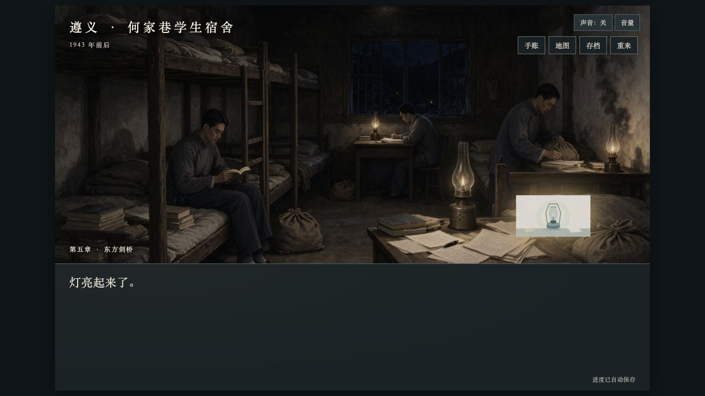
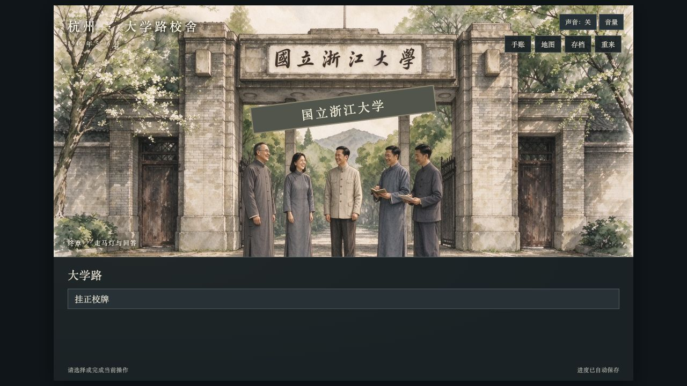

# 全流程图片核查 · 2026-10-24

> 同日后续修复：校牌已改为 `IMG-44` 无校牌背景＋透明 `IMG-45` 拖动道具，原下方按钮删除。以下校牌截图、复用数量和 4 处局部占位统计保留为修复前核查记录；当前校牌局部占位已消除，仍有 15 个整幅占位节点、3 个旧灯局部占位节点及走马灯 1 帧旧灯叠层。参见 [校牌交互生成提示词与验证记录](校牌交互生成提示词.md)。

## 核查范围与结论

已在独立本机 HTTP 实例从首页连续玩到最终两问，取得“真结局·求是”。主线实际显示 155 个剧情节点，另用独立测试存档补看主线未进入的 `fei-stop` 阻拦分支，共核对全部 156 个可显示节点；剩余的 `protect-branch` 是推进前立即解析的逻辑分支，不绘制自己的背景。

本次还逐一打开四件展品、经过七次章间地图、查看五帧走马灯，并检查点灯与挂牌的叠层。五种结局的文字共用一个结局节点，图片均为 `IMG-17`；匿名结局另加灰阶处理，本次没有把五种结局分别从头重玩。存档回顾的图片规则也按当前代码核对：普通记录按节点 ID 取当前图片，走马灯保留各帧图片；回顾弹窗不重绘灯具和校牌叠层。

当前仍有 **15 个完整背景占位节点、4 个局部占位节点，另有走马灯的 1 帧局部占位**。完整背景占位使用四张图：`IMG-05`、`IMG-11`、`IMG-12`、`IMG-13`；局部占位包括 `IMG-26` 灯具和 CSS 校牌。`_` 开头的备份均未被游戏引用。

本轮只增加核查报告及证据，不修改游戏代码、美术或剧情。独立测试实例不覆盖玩家原浏览器来源中的存档。

## 一、按章节标注占位画面

| 章节 | 完整背景占位 | 部分占位／叠层 |
| --- | --- | --- |
| 序章 | 无；校史馆、展品和剧情路线图均已更新 | 无 |
| 第一章 | 无；七张剧情图已对应接入 | 无 |
| 第二章 | 建德外景 `IMG-05`，3 个节点 | 无 |
| 第三章 | 无；夜读、测量、澄江学校、悼念和雨夜护书均已更新 | 无 |
| 第四章 | 草棚 `IMG-11` 1 个；典礼／会议 `IMG-12` 5 个；废墟 `IMG-13` 4 个，共 10 个 | 无额外旧道具叠层 |
| 第五章 | 李约瑟访问仍用 `IMG-12`，2 个节点 | `interaction-10` 点灯后、`scene-107`、`scene-108` 仍叠加旧灯 `IMG-26` |
| 终章 | 无完整背景占位 | `interaction-11` 挂牌前后仍使用 CSS 矩形校牌；走马灯第 4 帧仍叠加旧灯 `IMG-26` |

### 第二章：建德梅城外景，3 个节点

| 节点 | 剧情位置 | 当前文件 | 待补画面 |
| --- | --- | --- | --- |
| `scene-041` | 富春江边古城，白天上课、黄昏防空警报 | `IMG-05.webp` | 建德梅城、城墙防空哨或祠堂外景 |
| `scene-048` | 杭州陷落，梅城戒严，城墙灯笼熄灭 | `IMG-05.webp` | 梅城戒严／城墙暗夜 |
| `scene-049` | 在严子陵祠落脚，继续读书 | `IMG-05.webp` | 严子陵祠与避战办学 |

### 第四章：草棚、典礼会议、轰炸废墟，10 个节点

| 节点 | 剧情位置 | 当前文件 |
| --- | --- | --- |
| `scene-079` | 草棚临时教室、腰间木板、油灯照明 | `IMG-11.webp` |
| `scene-082` | 新学期开学典礼，校长讲王阳明 | `IMG-12.webp` |
| `scene-083` | 竺可桢讲艰危中立身报国 | `IMG-12.webp` |
| `scene-084` | “排万难、冒万死以求真知” | `IMG-12.webp` |
| `anthem-meeting-context` | 1938 年 11 月 19 日，定校训、请马一浮撰校歌 | `IMG-12.webp` |
| `scene-086` | “校训有了，校歌还没有” | `IMG-12.webp` |
| `scene-092` | 宜山遭轰炸、校舍残垣、扶出小满 | `IMG-13.webp` |
| `scene-093` | 何九章在烧毁的钢琴前捡起琴键 | `IMG-13.webp` |
| `scene-094` | 讲述钢琴一路抬到宜山而毁于轰炸 | `IMG-13.webp` |
| `choice-4` | 校舍尽毁后的复课、下乡或抢建宿舍选择及反馈 | `IMG-13.webp` |

`interaction-8` 拼校训已经使用绘制黑板 `IMG-39`，不是上述会议占位图；`scene-080`、`choice-3` 已使用校医处 `IMG-38`。`scene-087` 至 `scene-091` 已使用曲谱 `IMG-40`／`IMG-41`／`IMG-42`。

### 第五章：李约瑟访问与旧灯叠层

| 节点 | 剧情位置 | 占位部分 |
| --- | --- | --- |
| `scene-109` | 李约瑟来访，破庙内坚持教学研究 | 整幅背景 `IMG-12.webp` |
| `scene-110` | “中国最好的四所大学之一” | 整幅背景 `IMG-12.webp` |
| `interaction-10` | 点击“领取并点亮费巩灯”后的反馈画面 | 背景 `IMG-14` 已更新，前景旧灯 `IMG-26` 仍存在 |
| `scene-107` | 火苗立起，桌上的字变清楚 | 背景已更新，叠加旧灯 `IMG-26` |
| `scene-108` | “亮堂吧？还没烟……” | 背景已更新，叠加旧灯 `IMG-26` |

旧灯是独立 ``。只要当前背景为 `IMG-14` 且 `lampLit` 为真，就会显示；因此不能仅因宿舍背景更新，就认为灯道具也更新。实测还能看到旧图自带的浅色矩形底。`67/IMG-26.webp` 上次按“最后两张先不替换”的要求没有接入。

### 终章：校牌与走马灯

- `interaction-11`“挂正校牌”：校门背景 `IMG-17` 已更新，前景仍为 `
国立浙江大学
`。CSS 画出绿色矩形和边框，点击后从倾斜改为摆正；没有独立的正式校牌图片。
- 新校门背景本身已有“国立浙江大学”石刻，旧矩形牌叠上去会出现双重校名。这是局部占位，不是整张校门图仍未更新。
- `montage` 第 4 帧“遵义·费巩灯”：复用 `IMG-14`，在本次完整通关的已点灯状态下再次叠加 `IMG-26`，所以结尾回忆也要一并处理。

## 二、按章节列出图片复用

“次数”指不同剧情节点引用同一张图，不把打字机、长文翻页、重开弹窗、读档或同一节点的反馈再算一次。统计包含互斥分支节点；逻辑节点 `protect-branch` 不计入画面次数，`montage` 依据实际五帧单列。单张图在本章仅用一次、但在其他章节或展品里再用，也列入跨章节复用。

### 序章 · 照片里的录取

| 图片 | 本章节点数 | 本章用途／复用位置 |
| --- | ---: | --- |
| [IMG-01.webp](images/IMG-01.webp) | 3 | 校史馆：`start`、`scene-002`、`interaction-1` |
| [IMG-22.webp](images/IMG-22.webp) | 2 | 路线图（与 IMG-24 同一份图）：`scene-004`、`scene-005` |
| [IMG-19.webp](images/IMG-19.webp) | 展品 | 序章合影展品；第二章 scene-055 再用。 |

### 第一章 · 烽火开学

| 图片 | 本章节点数 | 本章用途／复用位置 |
| --- | ---: | --- |
| [IMG-28.webp](images/IMG-28.webp) | 2 | 门房递饼：`scene-008`、`interaction-2` |
| [IMG-29.webp](images/IMG-29.webp) | 8 | 山路三人同行：`scene-010`、`scene-011`、`scene-012`、`scene-013`、`interaction-3`、`scene-015`、`name-confirm`、`scene-017` |
| [IMG-04.webp](images/IMG-04.webp) | 1 | 抵达禅源寺：`scene-018` |
| [IMG-31.webp](images/IMG-31.webp) | 2 | 禅源寺开学：`scene-020`、`scene-021` |
| [IMG-22.webp](images/IMG-22.webp) | 导航 | 第一章章节导航；序章剧情和后续路线图为同一图源。 |

### 第二章 · 夜渡钱塘

| 图片 | 本章节点数 | 本章用途／复用位置 |
| --- | ---: | --- |
| [IMG-32.webp](images/IMG-32.webp) | 2 | 登陆消息／迁校布告：`chapter2-news`、`chapter2-start` |
| [IMG-03.webp](images/IMG-03.webp) | 4 | 迁校队伍跋涉：`scene-023`、`scene-024`、`scene-025`、`scene-026` |
| [IMG-33.webp](images/IMG-33.webp) | 13 | 草丛中发现小满：`scene-027`、`scene-028`、`scene-029`、`scene-030`、`scene-031`、`scene-032`、`scene-033`、`scene-034`、`scene-035`、`scene-036`、`scene-036-pause`、`scene-037`、`scene-038` |
| [IMG-34.webp](images/IMG-34.webp) | 2 | 牵着小满前行：`scene-039`、`scene-040` |
| [IMG-05.webp](images/IMG-05.webp) | 3 | 建德梅城外景〔占位〕：`scene-041`、`scene-048`、`scene-049` |
| [IMG-36.webp](images/IMG-36.webp) | 2 | 孙宅见校长：`scene-042`、`scene-043` |
| [IMG-06.webp](images/IMG-06.webp) | 4 | 古籍仓房验书：`scene-044`、`scene-045`、`scene-046`、`choice-1` |
| [IMG-07.webp](images/IMG-07.webp) | 7 | 周念东整理铺盖参军：`scene-050`、`scene-051`、`scene-052`、`scene-053`、`choice-2`、`choice2-join-reply`、`choice2-join-departure` |
| [IMG-19.webp](images/IMG-19.webp) | 1 | 十二人合影展品：`scene-055` |

### 第三章 · 文军长征

| 图片 | 本章节点数 | 本章用途／复用位置 |
| --- | ---: | --- |
| [IMG-24.webp](images/IMG-24.webp) | 1 | 路线图（与 IMG-22 相同）：`chapter3-start` |
| [IMG-08.webp](images/IMG-08.webp) | 2 | 白鹭洲夜读：`scene-057`、`interaction-5` |
| [IMG-09.webp](images/IMG-09.webp) | 6 | 赣江大堤测量：`scene-059`、`scene-060`、`scene-061`、`scene-062`、`interaction-6`、`scene-064` |
| [IMG-10.webp](images/IMG-10.webp) | 11 | 澄江学校与小满：`scene-065`、`scene-066`、`chengjiang-xiaoman-looks-up`、`scene-067`、`chengjiang-offer-school`、`scene-068`、`chengjiang-grip-broom`、`scene-069`、`scene-070`、`chengjiang-hold-sleeve`、`scene-071` |
| [IMG-37.webp](images/IMG-37.webp) | 2 | 悼念与侠魂奖学金：`scene-072`、`scene-073` |
| [IMG-35.webp](images/IMG-35.webp) | 3 | 雨夜护书：`protect-rain`、`interaction-7`、`scene-077` |

### 第四章 · 求是

| 图片 | 本章节点数 | 本章用途／复用位置 |
| --- | ---: | --- |
| [IMG-24.webp](images/IMG-24.webp) | 2 | 路线图（与 IMG-22 相同）：`chapter4-start`、`chapter4-he-narration` |
| [IMG-38.webp](images/IMG-38.webp) | 2 | 校医处／奎宁：`scene-080`、`choice-3` |
| [IMG-12.webp](images/IMG-12.webp) | 5 | 典礼／会议／李约瑟访问〔占位〕：`scene-082`、`scene-083`、`scene-084`、`anthem-meeting-context`、`scene-086` |
| [IMG-40.webp](images/IMG-40.webp) | 3 | 校歌曲谱首页：`scene-087`、`scene-090`、`scene-091` |
| [IMG-13.webp](images/IMG-13.webp) | 4 | 宜山废墟／钢琴〔占位〕：`scene-092`、`scene-093`、`scene-094`、`choice-4` |

### 第五章 · 东方剑桥

| 图片 | 本章节点数 | 本章用途／复用位置 |
| --- | ---: | --- |
| [IMG-24.webp](images/IMG-24.webp) | 3 | 路线图（与 IMG-22 相同）：`chapter5-start`、`audit-guizhou-hezhi`、`scene-097` |
| [IMG-14.webp](images/IMG-14.webp) | 11 | 遵义宿舍：`scene-098`、`interaction-9`、`scene-100`、`scene-101`、`scene-102`、`scene-103`、`scene-104`、`scene-105`、`interaction-10`、`scene-107`、`scene-108` |
| [IMG-12.webp](images/IMG-12.webp) | 2 | 典礼／会议／李约瑟访问〔占位〕：`scene-109`、`scene-110` |
| [IMG-15.webp](images/IMG-15.webp) | 9 | 费巩办公室：`scene-111`、`scene-112`、`audit-fei-future-memory`、`choice-5`、`fei-stop`、`fei-silent`、`audit-fei-lift-case`、`audit-fei-silent-reply`、`fei-gone` |
| [IMG-16.webp](images/IMG-16.webp) | 6 | 湄潭胜利街景：`scene-117`、`scene-118`、`scene-120`、`scene-121`、`scene-122`、`scene-124` |
| [IMG-43.webp](images/IMG-43.webp) | 2 | 湄潭灯火远景：`scene-119`、`scene-123` |
| [IMG-26.webp](images/IMG-26.webp) | 3 个节点的叠层 | `interaction-10` 点灯后、`scene-107`、`scene-108`；终章走马灯再用。 |

### 终章 · 走马灯与回答

| 图片 | 本章节点数 | 本章用途／复用位置 |
| --- | ---: | --- |
| [IMG-17.webp](images/IMG-17.webp) | 7 | 返杭校门：`chapter6-start`、`interaction-11`、`scene-127`、`ending`、`audit-farewell-chase`、`scene-130`、`scene-131` |
| [IMG-24.webp](images/IMG-24.webp) | 5 | 路线图（与 IMG-22 相同）：`scene-132`、`scene-133`、`scene-134`、`scene-135`、`scene-136` |
| [IMG-01.webp](images/IMG-01.webp) | 6 | 校史馆：`scene-137`、`scene-138`、`scene-139`、`scene-140`、`scene-141`、`reflection` |

走马灯另复用：第 1 帧 `IMG-04`、第 2 帧 `IMG-06`、第 3 帧 `IMG-09`、第 4 帧 `IMG-14`＋旧灯 `IMG-26`、第 5 帧 `IMG-16`。

## 三、跨场景复用中应优先补专图的位置

以下已经换成绘制图，不能再标成“旧占位图”；但同一图片与具体剧情细节并不完全对应。

| 位置 | 当前复用图 | 与剧情的差别／可补的专图 |
| --- | --- | --- |
| 第二章 `scene-055` | `IMG-19` | 直接复用序章展柜中的合影，历史字幕仍有现代展陈边框 |
| 第四章 `scene-087`、`scene-090`、`scene-091` | `IMG-40` | 曲谱首页同时用于作词介绍、抱文件回到 1938 年、校歌唱响 |
| 第五章 `fei-gone` | `IMG-15` | 正文已到重庆千厮门码头，仍为遵义办公室 |
| 第五章 `scene-124` | `IMG-16` | 正文是中正桥家人留影，仍为胜利夜街 |
| 终章 `interaction-11` | `IMG-17`＋CSS 校牌 | 正文讲断墙和挂牌，背景却是完整石门，且叠加矩形校牌 |
| 终章 `scene-127` | `IMG-17` | 正文是夏夜独行，仍为白天多人校门画面 |
| 终章走马灯第 1 帧 | `IMG-04` | 讲开学钟声与炮声，沿用抵达寺院／搬黑板图，而不是第一章开学图 `IMG-31` |

`IMG-22` 与 `IMG-24` 文件内容完全相同，是同一张路线图以两个位置名重复使用；不要把它们算成两张独立美术。

另一个已知素材文字问题：`IMG-39`（来自 `345/15.jpg`）黑板有 9 张字块，其中“行”重复。它不是旧占位图，但与界面中正确的 8 个可选字不一致，建议后续美术修正。

## 四、证据与统计口径

- [完整试玩与补充分支图片记录](核查/全流程图片试玩记录-2026-10-24.json)：包含节点、实际图片路径、背景可见性、灯具及校牌可见性。`supplement: true` 是补看的费巩阻拦分支。
- [费巩灯叠层截图](核查/费巩灯占位-2026-10-24.png)、[校牌叠层截图](核查/校牌占位-2026-10-24.png)。
- 图片引用核对包括主剧情、展品弹窗、章节导航、走马灯、五结局共用背景、回顾和道具叠层。源码中未被运行引用的 `_` 备份不计入残留。
- 第一章导航里的路线图是正式接入的 `IMG-22`。其余章节导航的 SVG 连线、数字圆点和锁定／完成按钮属于导航界面，本报告不把功能控件算作待替换的场景占位图。
- 本轮没有进行新素材生成、图片替换、提交或线上发布。
