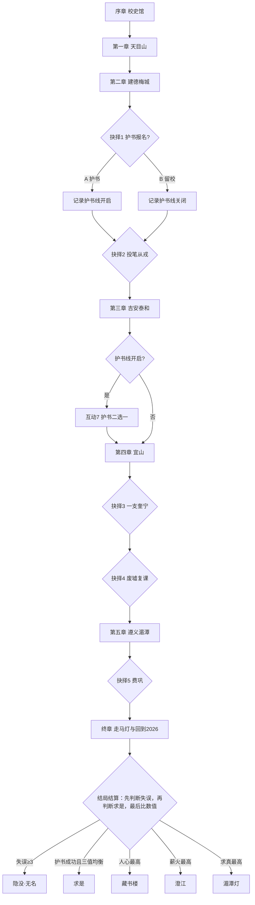

## 【格式规范 · 程序读取用】

| 标签                             | 含义                                                     |
| -------------------------------- | -------------------------------------------------------- |
| 【场景】【画面】【演出】【旁白】 | 演出指令                                                 |
| 【对话】                         | 角色台词，格式：**角色名**："台词"                       |
| 【互动 n：名称】                 | 玩家操作节点，附【操作】【结果】                         |
| 【抉择点 n：名称】               | 分支节点，每个选项附【数值变动】【分支走向】             |
| 【数值变动】                     | 三种数值：人心 / 薪火 / 求真；护书线单独记【护书完整度】 |
| 【手账】                         | 强制写入玩家手账的文本                                   |
| 【道具】                         | 进入背包的物品                                           |
| 【背景音乐】                     | 音频指令                                                 |
| 【图片 IMG-xx】                 | 使用对应编号图片；同一编号在多处复用，不代表新增素材       |
| 【实现简化】                     | 程序开发备注，不是玩家可见剧情文字                         |

## 【角色表】

- 史实人物：竺可桢、马一浮、费巩、束星北、杨守珍、李约瑟、郭斌龢、妙定方丈（异文"妙空"）、刘奎斗、张侠魂、王淦昌、谈家桢、贝时璋、陈建功、苏步青
- 虚构人物：玩家（默认名「江潮生」）、何九章、陈砚秋、周念东（原型参考刘奎斗等 12 位投笔从戎学生）、小满、门房、图书馆员、对铺同学

## 【制作说明 · 通识课轻量版】

- **游戏形式**：2D 网页视觉小说。保留全部主要章节、5 个核心抉择点和 5 种结局；以背景图、立绘、文字对话和选择按钮完成演出，不做人物自由移动、配音或复杂动画
- **统一交互**：点击继续／二三选一／选择题／点击字块，四类组件覆盖 11 个既有互动节点；不另做物理模拟、倒计时或动作躲避
- **剧情数据**：对话、选项、数值、条件分支、图片编号和手账文本存放在同一份结构化数据中；抉择点 1 的护书段落在第三章末播放，结束后回归主线。未加【对话】【旁白】【字幕】【手账】标签的史实说明默认仅供策划参考，不需要逐字展示给玩家
- **图片原则**：`【图片 IMG-01】` 表示调用一张固定素材；背景允许重复使用，光线变化、模糊、闪白、震动、字幕、角色进出场由 CSS 完成，不要求额外图片。完整素材清单见文末「附二」
- **实现优先级**：必做＝完整剧情、选择、三数值、手账记录、5 结局及基本测试；选做＝角色立绘、音效、历史图片局部放大；不做＝可操作背包、移动地图、视频剪辑、AI 实时生成图片
- **交付验收**：不依赖占位素材也应能从序章走到任意结局；PC 浏览器优先，手机仅做基本自适应；运行过程中可通过“返回标题重新开始”重玩，**不强制要求存档/读档系统**
- **道具说明**：【道具】仅作为手账或剧情获得提示，不需要开发背包管理界面
- **手账说明**：【手账】仅自动追加预设文字；结尾的两问可用可选输入框，不需要云端保存或生成图片
- **音效与音乐**：建议 1 首通用氛围乐＋1 首结尾音乐＋3 个通用音效；全部允许缺省静音，素材须确认授权

## 【5 次开发会话安排（建议每次约 2 小时）】

1. **第 1 次**：搭建共用场景、对话和选项组件，跑通序章与第一章
2. **第 2 次**：批量导入全部剧情，接通三数值、五个抉择点和护书支线；先确保占位图可通关
3. **第 3 次**：接入已交付图片，添加问答、测点二选一、拼校训及灯光切换
4. **第 4 次**：完成五结局、手账、简化走马灯及历史时间轴
5. **第 5 次**：组内全程试玩，修复分支和缺图问题，完善展示界面并部署至 Vercel

> 上述是目标计划，不是必达工时；若前 3 次未能跑通主线，优先取消可选立绘和特效，保证核心故事完整可玩

## 【程序统一结算规则】

- `人心 / 薪火 / 求真` 初始均为 `0`，按文中【数值变动】累加；未选择到的事件不加分
- `护书线开启` 初始为 `false`；抉择点 1 选 A 后为 `true`，且`护书完整度 = 1`；选 B 后护书完整度为 `null`；互动 7 选择正确保持 `1`，选错变为 `0`；该支线**不产生独立路线或单独结局**
- `互动失误数` 初始为 `0`：互动 5、6、8、9 中，**首次提交**未完成指定正确目标的节点各加 `1`，最多计 4 次；回答错误后可以继续剧情，不必重开或重试。不影响历史主线与角色生死
- 结局判断**依次进行，命中即停止**：① `互动失误数 >= 3` →【隐没·无名】；② `护书线开启 && 护书完整度 == 1 && max(三值)-min(三值) <= 2` →【求是】；③否则取三数值最高者 →【藏书楼】/【澄江】/【湄潭灯】
- 如果多个数值并列最高，按固定优先级 `人心 > 薪火 > 求真` 选结局，避免歧义；界面不需要显示复杂的好感度或成就系统
- 以上是**开发可执行规则**，新增的“互动失误数”只用于结局判定，不在游戏画面向玩家显示


# 第一卷 · 设定与序章【序章：照片里的录取】

## 0.1 玩家背景（开场创角）

【画面】黑屏，一行行打出：

> 你是浙江大学的一名大一新生。
> 2026 年 10 月，校史馆（紫金港月牙楼）举办「文军长征」特展，你作为志愿者被分去辅助工作。
> ——然后，你碰了不该碰的东西。

## 0.2 序章 · 校史馆（教学关）

【场景】校史馆展厅。
【图片 IMG-01】2026 校史馆展厅背景；展柜中的四件展品使用文本热点，不必各做独立图片

【道具】一根按动笔，一本手账本。

【互动 1：展品教学】玩家在展厅内点击 4 件展品，每件是一句伏笔：

| 展品                        | 点击后的解说              | 伏笔指向     |
| ------------------------- | ------------------- | -------- |
| 竺可桢西迁时随身带的箱子              | 「竺可桢西迁时随身带的箱子」      | 终章信物     |
| 1937 年 12 位投笔从戎学生合影（含刘奎斗） | 「他们投笔从戎，保家卫国」       | 投军线室友原型  |
| 竺可桢日记手稿                   | 「他记了一辈子日记，直到去世前一天。」 | 「求是手账」来历 |
| 护送路线图                     | 「2600多公里，没有一天停止办学」  |          |

【操作】点选四个展品对应的文字按钮；最后点「路线图」进入穿越，不做图片热区识别
【图片 IMG-24】西迁路线图，后续迁校转场复用
【穿越演出】最后点开路线图，手指沿着西迁路线移动。
心中感叹：当年西迁好艰苦啊！
手指回到杭州。
忽然，视线被地图上「杭州」一处吸住，画面白闪，传来快门声。
【实现简化】白闪、缩放与快门声即可，不做空间扭曲特效

> 字幕：你被录取了。八十九年前。

【手账】「2026，校史馆。竺可桢校长的日记手稿，把我扔进烽火连天的一九三七。」

# 第二卷 · 杭州 → 西天目山（1937.9）【第一章：烽火开学】

## 1.0 时代底噪

【画面】报纸号外飞落：七七事变、八一三淞沪会战。街上逃难的人挑着担子往南站。米价牌上的数字被人一次次改写。

【旁白】"民国二十六年，七月卢沟桥，八月上海。杭州的桂花照开，可报童喊的已经不是桂花的事了。"

## 1.1 报到即西行（1937.9.14–9.21）

1937 年 9 月，战事逼近杭州，浙大一年级新生转移西天目山禅源寺开课。杭州本部危在旦夕，迁校的消息在校内悄然流传。

【场景】杭州，国立浙江大学校门口。主角落地，手里捏着一张录取通知书，上面写着玩家自创的名字。
【图片 IMG-02】1937 年杭州校门背景

【对话】**门房**："新生？新生不上这儿报到——一年级迁天目山了，禅源寺。喏，路上吃。"（递来两个烧饼）

【互动 2：接物】
【操作】点击接过烧饼。
【结果】【道具】烧饼 ×2
【手账】「1937 年的烧饼，有点硬。」

【场景】去天目山的独轮车/山路上，同车的两人：
【图片 IMG-03】迁校山路背景；第二章步行途中复用
【图片 IMG-20】陈砚秋立绘（可选）
【图片 IMG-19】何九章立绘（可选）

- **陈砚秋**（土木工程系新生，绍兴人，抱着一个布包着的测量水准仪，不许别人碰）
- **何九章**（中文系二年级，建德人，怀里一把二胡）

【对话】**陈砚秋**："喂，新生。你这笔——"（她盯着你的口袋）
你回头看向口袋，口袋中竟然还有现代的按动中性笔？
陈：“——按一下就出水的？给我看看。"

【互动 3：递笔/不递】

- 【选项 A】递 → 她按了三下，还你："好笔。等到了天目山，借我画三天图纸。"【数值变动：人心+1（陈砚秋好感）】
- 【选项 B】不递 → 她撇嘴："小气。"【数值变动：无】

【对话】**何九章**："别理她。我叫何九章，九章算术的九章。你呢？"

【演出】此处弹出确认框：「我的名字是 ___ 」——玩家名字第一次被 NPC 叫出。

## 1.2 禅源寺开学（1937.9.21–9.27）

1937 年 9 月 14 日竺可桢与寺院方丈商定租借寺院余屋作新生教学生活用房；9 月 21 日新生迁至。

【场景】西天目山，禅源寺。
【图片 IMG-04】禅源寺背景
【画面】千年银杏，寺墙斑驳。妙定方丈收下了这批借宿的师生。僧人帮忙搬黑板。

【互动 4：安顿行李】
【操作】点击「放好行李」按钮即可，不做拖拽
【结果】【数值变动：无】（纯教学交互）

【收束镜头】9 月 27 日开学第一课。没有礼堂，大殿前的院子就是课堂。钟声响起时，山下隐约有闷雷滚过——僧人说是山雨。

【对话】**何九章**（低声）："是炮。"

【手账】「1937.9.27 天目山禅源寺。一座庙，开学的钟声和远处的炮声一起响。」

# 第三卷 · 建德梅城（1937.11–12）【第二章：夜渡钱塘】

## 2.0 时代底噪

【画面】11 月 5 日日军在杭州湾登陆的消息传开；街上人挤人，惊呼声与讨论声不绝于耳。

【旁白】**何九章**："十一月五号，日本人在全公亭登陆。学校布告贴出来：全校迁建德，水路，分批启程。"

## 2.1 初行（1937年11月下旬）

11月11日杭州本部师生分三批出发，11月15日全部抵达杭州西南约 120 公里的建德，图书仪器随迁。11月下旬，天目山师生亦全部抵达梅城汇合。

【场景】步行途中，暮色，山风卷着枯叶。队伍沿路跋涉，背着书籍、行囊，队伍拉得很长。
【图片 IMG-03】复用迁校山路背景；CSS 调暗表示暮色
【图片 IMG-21】小满立绘（可选，首次出场时显示）

【对话】**陈砚秋**：（回头，压低声音）（玩家名字），跟上些，前面转过山坳就有歇脚的平地。天快黑了，要赶在入夜前到达。

【演出】（你正要应声，正要迈步，听见路边枯草堆里传来极轻的抽噎声。）

【对话】**你**：（放轻脚步）你听。

【演出】（两人拨开枯黄的茅草，看见蜷缩在土坡下的小女孩。小女孩头发凌乱，裤脚划破，脚上的布鞋磨破了洞，看见来人，吓得往后缩，紧紧把包袱搂在胸前。）

【对话】**陈砚秋**：（放缓语调，慢慢蹲下身，不靠近）小朋友，别怕，我们是学生，不是坏人。你叫什么名字？

【对话】**小满**：（嘴唇哆嗦，声音细若蚊蚋）小……小， 小满。

【对话】**你**：（轻声）小满，你一个人在这里？你的爹娘呢？

【对话】**小满**：（眼泪一下子滚下来）路上…… 走散了。炮响的时候，娘把我推到草丛里。等我再出来，就找不到他们了。（把怀里的布包抱紧，里面是半块干硬的麦饼）我跟着逃难的人走，走不动，掉队了。

【演出】（山风掠过江面，远处隐约传来隆隆闷响。陈砚秋解下自己背上的粗布干粮袋，拿出一小块饼递过去。小满盯着干粮，不敢伸手。）

【对话】**陈砚秋**：拿着吃吧。

【对话】**小满**：（怯生生抬头，看向长长的队伍，看到大家背着书本仪器）你们…… 要去哪里？

【对话】**陈砚秋**：我们带着学校的书，往建德去。战火来了，可读书不能断。

【对话】**小满**：（小声）我能不能…… 跟你们一起走？我能捡柴，能帮着拿轻东西，我不拖累你们。

【演出】（你们面面相觑，沉默片刻。）

【对话】**你**：国难路上，没有人该被丢下。只是前路很苦，还要继续赶路。

【对话】**小满**：（用力点头，抹掉泪水，撑着地面站起来）我能走！我叫小满，我会好好跟着队伍。

【演出】（陈砚秋伸手，小心牵住小满冻得冰凉的小手，带着她追上前行的队伍。前方，师生们的身影在暮色里向着建德方向绵延而去。）

【对话】**你**：（低声对小满）跟着我们，前面，会有灯火。

## 2.2 梅城光景（1937.11.11–1937.12）

【场景】建德梅城。
【图片 IMG-05】建德梅城背景
【图片 IMG-22】竺可桢立绘（可选）

【演出】富春江边的古城，城墙上有防空哨。白天上课，黄昏警报一响，师生把黑板抬进祠堂深处接着讲。

【对话】**竺可桢**（主角第一次在剧情中近距离见到校长，孙宅门口，他正蹲着给脚上的水泡挑破）："新生？天目山下来的？"
（他抬头看你一眼）"脚上的泡，挑破了才好走路。学校也一样——疼一下，接着走。"

## 2.3 文脉西运

为抢救保存杭州文澜阁藏《四库全书》，浙大在西迁伊始就协同浙江省立图书馆迁运《四库全书》至建德。

【场景】深夜。木箱摞到房梁。图书馆员开箱验潮，你在打下手。
【图片 IMG-06】古籍与木箱仓房背景

【对话】**图书馆员**："乾隆年间抄的，太平军进城那年散过一回，一页一页赎回来补的。杭州人守了它一百年。"
（他把一函书递给你）"小心点，别掉了。"

【抉择点 1：跟书走】学校征学生义工，随押运队送书往内地：

- 【选项 A】你报名 → 【分支走向】开启"护书支线"：第三章多出一段押运路剧情【数值变动：薪火+1；护书线开启】
- 【选项 B】你不报名，留在泰和【数值变动：求真+1；护书线关闭】

【收束镜头】12 月 24 日，杭州陷落。梅城戒严。城墙上的灯笼一夜全灭。

【旁白】**何九章**："十二月二十四，杭州没了。我们在梅城的严子陵祠落脚。严先生当年不肯做官，躲到江边钓鱼；我们不一样，我们是躲着，还要把书念完。"

【手账】「1937.11 建德梅城。警报声声，我们躲着战火，捧着古书，要把文脉一路护往内地。」

## 2.4 参军卫国

日寇的疯狂侵略使同学们义愤填膺。1937 年底，12 名浙大学生脱下长衫，换上军装拍了一张合影，参加浙东游击队。

【场景】宿舍中
【图片 IMG-07】1937 年学生宿舍背景
【图片 IMG-23】周念东立绘（可选）

你铺位旁边的铺盖已经卷好了，用麻绳捆得方方正正。周念东蹲在地上，往包袱里塞最后一样东西——是他那本《物理学概论》，塞到一半，又抽出来，放回桌上。

【对话】
**周念东**："书带不动了。留着给你。"
**你**："你真要走？"
**周念东**（他顿了顿，声音低下去）："我昨晚想了一宿。国家有难，我要去参军保家卫国。……你要不要一起来？"

【抉择点 2：投笔从戎】

- 【选项 A】「仗有人打，书也要有人读。留下来」【数值变动：薪火+1】
  → 他盯着你看了一会儿，把桌上那本《物理学概论》推给你："那你替我把它读完。"第二天天亮，他的铺位空了。
  【手账】"我留下了。不知道他怪我，还是怪他自己没怪我。"

- 【选项 B】「和他一起去」→ "我也一起去！"【数值变动：人心+1】
  → 他愣住，然后拍了拍你的肩膀，笑了，笑得有点苦：
  **周念东**："你还是一年级新生，先在校好好学习。仗要人打，书也要人读。"
  他摆摆手，没让你送。第二天天亮，铺位空了。桌上压着一张纸，是那本《物理学概论》的扉页写着一行字："替我读下去，等我回来考试。"
  【手账】"我报名了，但他拒绝。他说仗有人打，书也要人读"

【史实收束 · 画面定格】字幕渐显，可叠加 12 人合影的真实照片：
【图片 IMG-25】1937 年投笔从戎学生合影（史料图片，找到并核实来源后使用；若无法授权则用文字卡替代）

> 1937 年底，浙江大学学生刘奎斗等 12 人投笔从戎，奔赴浙东战场。但他们出发时站过的地方，是同一个学校。

【实现简化】周念东离队后不另开角色重逢场景；终章回顾时可闪回此处的合影或宿舍画面

# 第四卷 · 吉安 · 泰和（1937.12–1938.9）【第三章：文军长征】

## 3.0 时代底噪

【图片 IMG-24】复用西迁路线图
【画面】路线图静态展示：建德—金华—南昌—樟树—吉安，依次高亮地名；不制作路径动画

【旁白】**何九章**："十二月二十四号，我们从建德分批启程。坐船、搭车、走路，有的从常山走到玉山。第二年一月，到了江西吉安；二月，又迁泰和。"

## 3.1 吉安借读（1938.1–2）

泰和校舍未就绪，学校在吉安临时安顿，吉安的吉安中学（白鹭洲书院旧址）、吉安乡村师范放寒假校舍空置，学校决定借屋临时开课，不中断学期教学，净居寺（青原山）、阳明书院作部分课堂、临时用房使用。两周后期末考试，休整 1 周，2 月 18 日迁泰和。

【场景】吉安，白鹭洲书院。
【图片 IMG-08】白鹭洲书院夜景

【互动 5：白鹭洲夜读】
【操作】共 3 道单选题，使用通用选择按钮组件；一次性提交，3 题全对则【数值变动：求真+1】
【结果】非全对：不加求真，且【互动失误数+1】；仍然进入后续剧情。仅首次提交计入判定

【题目】

1. 竺老两问具体内容：【答案 B】
   A. 到浙大来做什么？毕业要做什么样的人？
   B. 到浙大来做什么？将来毕业后要做什么样的人？
   C. 到浙大来做什么？将来毕业后要成为什么样的人？
   D. 到浙大来做什么？毕业要成为什么样的人？
2. 浙大本部师生从哪天开始迁往建德？【答案 B】
   A. 1937 年 11 月 5 日
   B. 1937 年 11 月 11 日
   C. 1937 年 11 月 15 日
   D. 1937 年 11 月 13 日
3. 哪所学校是白鹭洲书院旧址？【答案 D】
   A. 吉安乡村师范
   B. 阳明书院
   C. 净居寺
   D. 吉安中学

【演出】有错题则触发以下对话；全对直接进入泰和剧情——
**何九章**（嘲讽）："白鹭洲是文天祥读过书的地方，你给我考成这样？"

## 3.2 泰和（1938.2–9）

1938 年，浙大与泰和地方合作，在当地修筑防洪堤、扩建赣江码头、创设澄江学校、开辟沙村示范垦殖场。

### 第一件事 · 赣江堤

【场景】赣江堤
【图片 IMG-09】赣江大堤施工场景

地方出资出劳、浙大出技术，修筑 1.5 公里防洪堤，人称"浙江大学堤"，4 月底开工，6 月底完工，8 月建成"浙大码头"。

【演出】陈砚秋挎着测绘仪器，手里攥着图纸。你帮她扛着三脚架，一同走在泥泞河滩。你将三脚架扎进松软滩土，架设好水平仪，江面的日光反射在镜片上，晃得人不由眯起双眼。

【对话】
**陈砚秋**："这里地基松软，三脚架一定要踩实。堤是要替泰和挡几十年水的，半分数据都马虎不得。"

【演出】二人俯身紧盯仪器，反复调整校正，一次次记下堤段高程读数。几番核对，一组组可靠的测量数据终于完整记录在测绘本上。

【对话】
**陈砚秋**（低头落笔记下最后一组数字，指尖沾了泥土）："高程若是差上几寸，汛期大水一来，田地村落便都要受淹。我们来到此地，不只是读书求学，更要做落地实在的事。去下一个测点吧。"

【互动 6：测量小游戏（简化为二选一）】
【操作】陈砚秋问：在松软河滩上架设水平仪，首先应当怎么做？
- 【选项 A】踩稳三脚架并复核水平（正确） → 【数值变动：求真+1】
- 【选项 B】不必校准，直接记录高程（错误） → 【互动失误数+1】
【结果】两种答案都继续剧情；不制作测量仪器模拟

【手账】「1938 年，泰和。赣江边跑测量，一寸一尺，修的是保命的大堤。」

### 第二件事 · 澄江学校

为使当地农村儿童和搬迁中的浙大教工子弟得到良好教育，浙大在泰和创设澄江学校，对当地教育事业发展起到推动作用。

【场景】澄江学校，小满正帮着打扫院子，手里拿着一把破旧竹扫帚。
【图片 IMG-10】澄江学校场景

【对话】**你**：小满，你想读书吗？

【对话】**小满**：（猛地抬头，眼里有光，又很快黯淡下去）想…… 可是我没有书本，也没有钱交学费。

【对话】**你**：（笑着蹲下身，指向祠堂内读书的孩童）别担心，这里是浙大办的澄江学校。这学堂不光收教职工的孩子，乡间、逃难来的孩子也能入学，不收学费。我想送你来这里上学。

【对话】**小满**：（攥紧扫帚，声音微微发颤，不敢相信）真的？我也可以上学？

【对话】**你**：当然。竺校长之所以创办澄江学校，就是希望战火之中，孩子们也能有书可读。只要你愿意读书，就可以来。

【对话】**小满**：（眼眶一下子红了，丢下扫帚，用力攥住你的衣袖）我愿意！我一定会好好读书！

【手账】「1938 年，泰和。孩童眼里的光，是乱世中不灭的求学希望。」

### 第三件事 · 侠魂

西迁办学途中，医药条件极差，师生一旦生病，便面临缺医少药的困难。竺校长夫人张侠魂与次子竺衡感染痢疾，相继病殁，令师生悲痛不已。而这时竺可桢校长正在前往广西考察新校址的路上，没有见到儿子的最后一面。

张侠魂女士去世后，竺可桢校长为纪念亡妻，于 1939 年 2 月捐出 1000 元积蓄在浙江大学设立"侠魂女士奖学金"，专门资助家境清寒且成绩优良的二、三、四年级女生。

【手账】「1938 年夏，泰和。校长的夫人和二公子留在了这里。后来有个奖学金，叫侠魂女士奖学金。」

## 3.3 护书支线（抉择点 1 选 A 才有）

【实现简化】护书支线在第三章末尾插入一幕，不改变主线时间轴；结束后所有玩家都进入第四章宜山。
【场景】押运队继续西行。
【图片 IMG-03】复用迁校山路；雨夜效果由 CSS 叠加，不另外准备洞口背景

1939 年《四库全书》最终迁至贵阳地母洞，竺校长几次到地母洞作保藏指导；1942 年 5 月 10 日浙江省立图书馆文澜阁《四库全书》贵阳地母洞藏书库照片存世。

【互动 7：过山洞（简化为二选一）】
【操作】夜路遇雨，独轮车陷泥，选择如何先处理书箱
- 【选项 A】先把书箱移到高处避雨（正确） → 【数值变动：薪火+1；护书完整度保持 1】
- 【选项 B】先推车继续赶路（错误） → 一函受潮，【护书完整度 = 0】
【结果】显示一句反馈，随后直接返回主线；不做限时点击和拖拽


# 第五卷 · 广西宜山（1938.10–1939.11）【第四章：求是】

## 4.0 时代底噪

【图片 IMG-24】复用西迁路线图
【画面】1938 年 7 月末九江陷落；10 月广州、武汉相继失守。用字幕配合路线图，不另做战线扩张动画

【旁白】**何九章**："七月九江丢了，泰和待不住。校长去广西看了地，全校迁宜山。水路旱路换着走，有的学生走了四十天。"

## 4.1 草棚大学（1938.10–11）

1938 年 10 月浙大师生抵达宜山，以原工读学校为总办公室，文庙、湖广会馆为礼堂与教室，在东门外标营搭盖草屋作为临时教室和学生宿舍。校内无通电，夜间用小油灯照明；教室座位不足，部分学生站着听课，用布带拴小木板挂在腰间记笔记，人称"鸡肠带笔记板"。1938 年 10-11 月全校疟疾患病者达 146 人，其中恶性疟疾占 77%；12 月新发病例仍持续增加，累计不下二百起。

【图片 IMG-11】宜山草棚大学背景（此处作为校医处的共用背景）
【抉择点 3：一支奎宁】校医处只剩最后一支奎宁。陈砚秋烧得说胡话；排在你们前面的，还有个烧得同样厉害的一年级学生。

- **A 给陈砚秋**【人心+1】→ 你开口求校医："她是我们一道修堤的。"前面同学看了看，让给了陈砚秋。砚秋退了烧。三天后你听说一年级那个学生转重症送县城的名单。手账：「我选了认识的人。这算不算错，我不知道。」

- **B 按规矩，给排在前面的学生**【求真+1】→ 砚秋烧了一周，撑着来上堤防图纸课，没提这事。手账：「校长说，只问是非，不计利害。做起来比听起来难。」

- **C 建议拆半**→ 校医直接拒绝："剂量不够，等于两个人都耽误。"【不改数值，退回重选】

## 4.2 开学典礼与"求是"（1938.11.1 / 11.19）

1938 年 11 月 1 日举行新学期开学典礼，竺可桢发表《王阳明先生与大学生的典范》演讲；11 月 19 日校务会议正式通过决议，以"求是"为校训。校训语出王阳明"君子之学，岂有心于同异，唯求其是而已"。竺可桢阐释"求是精神"为"排万难、冒万死以求真知"，核心有三：一是不盲从、不附和，只问是非，不计利害；二是不武断、不蛮横；三是专心一致，实事求是。

【对话】**竺可桢**：

> "今浙大以时局影响而侨江西，而入桂，正是蹑着先生的遗踪而来；这并不是偶然的事，我们正不应随便放过，而宜景慕体念，接受他那艰危中立身报国的伟大精神。"
> "求是精神，就是排万难、冒万死以求真知的精神。"

【互动 8：拼校训】
【场景】校务会议场景，你作为学生记录员旁听。黑板上字块散落：求 / 是 / 力 / 行 / 敦 / 品 / 格 / 致。
【图片 IMG-12】宜山文庙／校务会议场景
【操作】依次点击两个字块，点「确认」提交；不用拖拽

- 【结果 A】拼出"求是"→ 全场静默三秒，校长说："记下吧。"【数值变动：薪火+1】
- 【结果 B】拼错 → 校长不否定你，只问："你选这两个字，依据是什么？"手账自动写入一句预设理由【数值变动：无；互动失误数+1】（保留「评价依据」的主题，不做自由输入与 AI 评分）

【场景】1938.11.19 校务会议，定校训的同时决定请马一浮撰校歌歌词

【对话】**竺可桢**："校训有了，校歌还没有。请先生赐词。"

【画面淡出，进入插叙——字幕注明"后来"】

马一浮的词很快写成了：四言文言，一百四十八字，开篇是"大不自多，海纳江河"

竺校长喜欢它，也犯愁它——文理太深。

【字幕，一行一行浮出】

> 1941 年 6 月，请国立音乐学院应尚能教授谱曲。
> 同年 8 月 7 日，应教授谱曲完成寄回。
> 同年 11 月 10 日，在遵义举行纪念周时，竺校长请中文系郭斌龢教授讲解歌词，并由歌咏队员演唱一次，近 3 分钟，竺校长认为讲解和演唱均甚好。

【插叙结束，画面回到 1938 年的祠堂】

【演出】你帮先生们抱着那摞文件出门。你不知道的是，你怀里的某一张纸，要等三年才唱得出声；而等它唱出声的那一天，这首歌会一直被唱到你来的那个年代——

> 大不自多，海纳江河。惟学无际，际于天地。【背景音乐：校歌】

【手账】1938 年，马一浮先生为校歌作词。
1941 年，校歌正式确定。大不自多，海纳江河。惟学无际，际于天地。

## 4.3 轰炸（1939.2.5）

宜山虽位处西南，也常遭日本侵略军飞机的空袭。1939 年 2 月 5 日，日寇以浙大为目标，进行猛烈的轰炸。敌机 18 架，先炸西门汽车站一带，而后，敌机在标营一地竟投燃烧弹、爆裂弹 118 枚之多。炸毁浙大标营东宿舍 8 间、大礼堂一幢、新教室三幢计 14 间，其余如导师办公室、体育室、事务课办公室、阅报室、厨房、储藏室、饭厅及杂室等亦被毁或不能住人。浙大迁校时带去的唯一的一架钢琴也毁于一旦。遵义城内工学院院长李寿恒、文理学院院长胡刚复、校长办公室秘书诸葛麒的住屋均被炸塌一角，幸人员无恙。

【图片 IMG-13】宜山轰炸废墟背景
【演出】用一张废墟背景、警报音效、短暂白闪与屏幕震动表现轰炸；不开发跑酷或躲避小游戏

1. 警报骤响，画面闪白，字幕提示众人奔向掩体
2. 画面切换到废墟，你从阅览室残垣中扶出小满（对话呈现，不做拖拽）
3. 何九章在烧毁的钢琴前捡起一枚琴键，之后他的二胡成了全校的"乐队"

【对话】
何九章："全校就这么一架琴。从上海跟着船，一路抬到宜山，没舍得丢。今天没了。"


【抉择点 4：废墟上的课】校舍尽毁，有教授提议停课一月：

- 【选项 A】露天复课，黑板挂上榕树【数值变动：人心+1】
- 【选项 B】分组下乡做灾情与田野记录【数值变动：求真+1】
- 【选项 C】先抢建宿舍【数值变动：薪火+1】，但触发学生情绪事件：有人夜里哭，你去陪坐

# 第六卷 · 贵州遵义 · 湄潭（1939.11–1945）

# 【第五章：东方剑桥】

## 5.0 时代底噪

【图片 IMG-24】复用西迁路线图
【画面】1939 年 11 月南宁陷落。学校派人去遵义、云南建水勘察新校址。浙大师生迁到遵义、湄潭等，从此在相对安静的黔北地区，赢得了近七年比较稳定的办学时间。

【旁白】**何九章**："南宁一丢，宜山也待不住了。这一回，去贵州。湄潭县的严县长带人在城门口接，把全县最好的房子都让给了我们。"

## 5.1 进城（1940 年初）

1939 年 11 月，随着广西南宁陷落，国立浙江大学迁往贵州，总部设在遵义子弹库，并在湄潭设立分部。
1940 年 1 月，国立浙江大学在贵阳南青岩设立一年级分校。

## 5.2 费巩灯（1943 前后）

遵义时期，学生夜里读书仍在用桐油灯。灯焰小，油烟重，宿舍里常年蒙着一层昏黄，熬久了连鼻孔都会被熏黑。
正是在这点被烟熏得发暗的光里，竺可桢起了改良油灯的念头。后来那盏更亮、更净的灯，被浙大人称为“费巩灯”。

【场景】何家巷学生宿舍，夜。上下铺，你盘腿坐在床上，就着一盏桐油灯写作业。画面边缘一圈油烟般的暗晕。
【图片 IMG-14】遵义宿舍夜景；互动 9 与互动 10 共用这一张背景
【演出】CSS 暗角与轻微模糊营造油灯昏暗的感觉；文字保持正常字号，保证可读性

【互动 9：灯下做题】
【操作】替《浙大日刊》校样挑错字：「国难党头」哪一字有误？点击字块「国／难／党／头」即可，不做图片圈画
【结果】首次选「党」正确 → 【数值变动：求真+1】；否则【互动失误数+1】，提示正确字是「当」，继续剧情
【演出】保持同一张背景，四周仍有暗角，不另生成一张图片

【演出】做题做到一半，你打了个喷嚏——指节一抹，鼻孔两道黑。对铺同学笑："都一样，明早洗脸水都是黑的。"

竺可桢校长推门进来
你：（小声）先生……
校长没说话，站在你床边看了很久那盏灯，又看了看你们揉眼睛的手。

后来
竺可桢校长请**束星北、杨守珍**两位教授改良设计植物油灯：在废弃的铁香烟罐里放植物油和灯芯，加盖玻璃灯罩，罐身戳小孔，并以铁片导热为油加热——改良后的油灯明亮稳定、不起浓烟。设计完成后，**费巩**自行出资做了 800 余盏发给学生。学生感念其关爱，亲切地称这种油灯为"**费巩灯**"。
当年的学生回忆："油灯的光焰，像孩子的一双闪动的明眸。微弱的灯火，明净而澄洁。它给人光亮，它给人温暖。"

【互动 10：领灯】
【图片 IMG-26】费巩灯特写，画面角落展示；可先使用带出处的史料照片或简单道具绘图
【操作】几天后，总务处门口排起长队。点击「领取并点亮费巩灯」一次即可
【结果】【道具】费巩灯；【数值变动：人心+1】。回到宿舍点亮：**CSS 移除原有暗角滤镜，背景逐渐变亮**。不再新增第二轮找错字小游戏

【对话】**对铺同学**："亮堂吧？还没烟。听说费先生垫了自己好几个月的薪水。我们都叫它——费巩灯。"

【手账】「1943 年，遵义。费先生给我们一人做了一盏灯。后来我才懂，他给自己留的，是黑。」

## 5.3 东方剑桥（1940–1944）

遵湄办学七年，名教授讲授基础课程，学术空气浓厚。教授成果：王淦昌的"中微子研究"、谈家桢的"瓢虫色斑遗传变异"、贝时璋的"丰年虫细胞重建理论"、竺可桢的"二十八宿起源之时代与地点"、陈建功的"三角级数及单叶函数"、苏步青的"古典微分几何"。
英国科学史学家、皇家学会会员、英国驻华文化与科学协作代表团团长李约瑟博士与夫人来到处于遵义办学的浙大访问，对浙大在艰苦条件下的学术氛围之浓、师生科研水平之高十分惊叹，称誉浙大为"东方剑桥"。

【对话】**李约瑟**（望着文庙的破屋檐，笑了笑）："Chekiang University, one of the best four in China."——栖身破庙，却是中国最好的四所大学之一。

【手账】"1944 年，湄潭。我们是中国最好的四所大学之一。我把这句话抄在手账上，灯下看了一遍又一遍。"

## 5.4 费巩（1945.3）

1945 年 3 月，费巩教授应邀赴重庆北碚复旦大学讲学，3 月 5 日凌晨在重庆千厮门码头失踪。竺可桢四处查问，学生罢课抗议，营救无果。（遇害真相为后世考证，游戏内不呈现，只留白。）

【演出原则】这是全剧最安静的一章。配乐可以有雨声。

【场景】出发前夜，遵义。费巩在办公室收拾书稿，你帮他捆书。
【图片 IMG-15】遵义办公室背景
【图片 IMG-18】费巩立绘（可选）

【对话】**费巩**："绳子捆紧些。书比人娇气，人淋了雨会干，书不会。"

【演出】（你拥有未来记忆——你知道他回不来了。）

【抉择点 5：千厮门 · 费巩】

- 【选项 A】拦他【数值变动：薪火+1】

【对话】你把你知道的、将来会发生的一切，断断续续全说了。他一直没有打断你，只是把灯罩取下来，擦了擦，又装回去。

**费巩**："你说的事，我信一半。但讲学是我的事。北碚的学生等着我——就像当年你们等着这盏灯。灯做好了，没有不送出去的道理。"

- 【选项 B】不拦【数值变动：求真+1】

【演出】你几次想开口，最终什么都没说。他捆好最后一道绳，直起身，看见你还站着。

【对话】
**费巩**："还有事？"
（你摇摇头，替他提起箱子）
**费巩**（笑了笑）："回来给你们讲北碚的事。灯下读书，别凑太近。"

【后续】3 月 5 日凌晨，千厮门码头，寻遍渡船不见先生……

【手账】

> 「1945.3.4 夜，遵义。我送费先生到校门口。灯是他送的，光是留给我们的。」

## 5.5 胜利（1945.8–9）

【场景】1945 年 8 月，日本投降的消息传到湄潭。
【图片 IMG-16】湄潭夜街庆祝胜利场景

【演出】画面从一场夜戏开始：文庙的费巩灯还亮着，街那头忽然炸开一挂鞭炮，接着是第二挂、第三挂，整条街的狗都叫起来。你和同学举着灯冲出门，街上已经全是人——有人哭，有人笑，有人把洗脸盆敲得山响。一个教授站在人堆里，一遍遍地说"胜利了"，声音是哑的。

【演出】字幕与渐亮效果：湄潭镇子的灯一盏一盏亮起来，文庙、祠堂、民居，漫山遍野的火光，像八年前梅城码头的那批箱灯，终于被一盏一盏重新点亮。
【实现简化】仅在同一背景上叠加暖色光点和渐亮，不做镜头升空或群像动画

【演出】此段不设选项。你在人群里走，碰到谁：

- 【对话】**何九章**："你还记得天目山吗？那年钟声和炮声一起响。现在好了，书一页不少，人也都在。"
- 【对话】**小满**："灯还点吗？"——"点。路还长。"

【字幕】

> 1945 年 8 月，抗战胜利。
> 此时距杭州沦陷、浙大师生出走，已整整八年。
> 来时 2600 里，师生行李之外，是 140 箱《四库全书》、两三百箱图书仪器。
> 它们都还在。
> 9 月 5 日，竺可桢与家人在遵义中正桥边留影（此处用字幕呈现，不额外要求一张照片）

---

# 第七卷 · 归来（1945.10–1946.6 / 2026）【终章：走马灯与回答】

## 6.1 返杭

1939 年 7 月浙大在龙泉设分校，设文、理、工、农、师范五个学院；1945 年 10 月龙泉分校师生率先返杭。1946 年 5 月 7 日遵义总校启程回杭，"别兮，遵义"（1946 年 5 月复员归杭照片注）。
大学路校舍断墙残垣，你踩着凳子把"国立浙江大学"的木牌挂正。
【图片 IMG-17】1946 年返杭校门背景
【互动 11：挂木牌】
【操作】点击「挂正校牌」按钮，播放校牌轻微旋转归位的 CSS 动画；不做拖拽

【背景音乐】校歌纯音乐
【素材链接】[竺可桢纪念馆](https://xsg.zju.edu.cn/2/index.html?scene_id=46910284)

## 6.2 走马灯（简化演出）

【触发】1946 年夏夜，你独自走过校园，白光渐起——你要"回去"了。

【演出】30–45 秒的固定 5 页图片轮播，使用已经出现过的背景：IMG-04、IMG-06、IMG-09、IMG-14、IMG-16；每页淡入淡出，配一条该章节已有的【手账】文字。
【实现简化】不回放所有分支、不制作「未选择路线」灰白画面；仅第 5 页附上一句由抉择点 1 决定的短字幕：护书成功＝「那些书，最终到了安全的地方」；其他情况＝「仍有人继续护送书卷西行」。允许点击「跳过回顾」

## 结局

【演出】显示结局名和对应文字；使用既有背景素材加滤镜，不新增 5 张结局插画。下列判定统一遵循开头【程序统一结算规则】

**① 真结局 ·【求是】**（触发条件：失误数 < 3；抉择点 1 选 A，互动 7 成功，且 max(三值) − min(三值) ≤ 2）

> 何九章："先生们让我送你一句话——你这趟没白来。书在，人在，'是'也在。"他把灯放进你手里："带走吧，它认你。" 白光起时，你听见全队列队唱校歌，唱的是送别的调子。

**② 【藏书楼】**（触发条件：前两项未命中，且人心为并列优先级判断后的最高值）

> 何九章："你啊，一路尽顾着替别人扛东西了。"他塞给你一张收条——泰和侠魂基金那张的摹本，"书都到家了，你放心。"

**③ 【澄江】**（触发条件：前两项未命中，且薪火高于人心、且薪火 ≥ 求真）

> 何九章展开一卷纸：是泰和大堤的图，堤上刻着密密麻麻的名字，最末一个空着。他把笔递给你："这个位置，给你留的。"

**④ 【湄潭灯】**（触发条件：前两项未命中，且求真严格高于人心与薪火）

> 何九章："先生们说，你的笔记比课代表还全。"他指给你看——文庙窗前一盏盏灯次第点亮，"看吧，这都是你们这样的人，一盏一盏传下来的。"

**⑤ 【隐没 · 无名】**（触发条件：互动 5、6、8、9 的首次作答失误达到 3 个或以上；优先于其他结局）

> 走马灯放到一半，画面忽然褪成灰白，人影一个个淡去。何九章的声音很远："……怪了，我怎么记不起你的脸了？"白光里只剩那本手账，纸页上字迹模糊，唯独"求是"二字还清晰。

【告别戏】白光中何九章追出来：

【对话】
**何九章**："你老说你是从以后来的。那以后——我们赢了吗？"
**你**："赢了。你们做的事，八十九年后还有人记得。"

## 6.4 "纪录片"段（简化为文字时间轴）

【图片 IMG-24】复用西迁路线图，时间轴由文字和 CSS 依次显现；无需单独视频或新插画

【旁白】

> 1946 年 6 月，国立浙江大学复员杭州。
> 1949 年 5 月 3 日，杭州解放。竺可桢卸任校长，北上出任中国科学院副院长。
> 1952 年，全国院系调整。浙大的院系散入多所高校。
> 1988 年 5 月 5 日，校务会议决定：校训在"求是"之后，添上"创新"二字。
> 1998 年 9 月，浙江大学、杭州大学、浙江农业大学、浙江医科大学合并，新的浙江大学诞生。

## 6.5 回到 2026

【场景】校史馆，你趴在展柜前惊醒。
【图片 IMG-01】复用序章校史馆背景

【演出】窗外是 2026 年的阳光，展厅里安静得能听见空调声。讲解员的声音远远传来："……浙大西迁，行程 2600 多公里，历时八年多……"

【演出】你低头，发现自己手里还攥着那本手账。（特写：手账翻开，里面是你这一局写下的所有记录。）

【独白】

> 原来不是梦。他们在破庙里点的灯，真的亮到了今天。
> 竺校长当年问了浙大人两个问题：到浙大来做什么？将来毕业后要做什么样的人？八十九年前，他们用 2600 多公里回答了一遍。现在，轮到我了。

【演出】画面定格在手账的最后一页，显示竺可桢校长的两个问题；如时间允许，可在页面中填写文字，不要求保存或导出。最后两个字 **求是**。

【演出】黑屏，出校歌。有字幕。【背景音乐：校歌】

---

# 附一 · 情节走向树状图（已修订）




---

# 附二 · 图片素材清单（交给图片组）

> **总量：26 个编号＝14 项必需素材＋12 项可选素材**  
> **建议先做 12 张必需背景＋1 张路线图＋1 张费巩灯道具，共 14 项**；另有 5 张可选背景、6 张可选立绘和 1 张可选史料照片。所有非必需图片都要有缺图备用方案，不能阻塞上线  
> 图片组尽量选择一种统一风格，例如复古插画／暖灰水彩／史料照片拼贴；不要不同章节混用照片和写实 AI 图  
> 检索关键词仅供寻找参考资料或可用素材，不代表已核实史实、照片年代或使用权；历史照片须核实来源及授权

## 2.1 素材编号和搜索关键词

| 编号 | 优先级 | 类型 | 图片描述与用途 | 建议搜索关键词 | 使用位置 |
| --- | --- | --- | --- | --- | --- |
| IMG-01 | 必需 | 背景 | 现代浙大校史馆展厅，展柜、路线图与文字说明；序章和2026结尾复用 | 浙江大学 校史馆 展厅 文军长征 特展 | 0.2、6.5 |
| IMG-02 | 必需 | 背景 | 1937 年杭州国立浙江大学校门，民国校园街景 | 国立浙江大学 1930年代 校门 杭州 老照片 | 1.1 |
| IMG-03 | 必需 | 背景 | 1930 年代山区迁徙道路，挑担背书的师生队伍；黄昏和雨天用滤镜复用 | 浙大西迁 师生 徒步 天目山 山路 老照片 | 1.1、2.1、3.3 |
| IMG-04 | 必需 | 背景 | 西天目山禅源寺，寺院院落、古树、临时课堂 | 西天目山 禅源寺 浙江大学 西迁 | 1.2、走马灯 |
| IMG-05 | 必需 | 背景 | 1937 年建德梅城古城街巷／江岸、古建筑 | 建德 梅城 古城 旧貌 富春江 | 2.2 |
| IMG-06 | 必需 | 背景 | 木箱堆放的古籍仓房，书函、防潮检查，体现《四库全书》押运 | 文澜阁 四库全书 西迁 书箱 古籍 | 2.3、走马灯 |
| IMG-07 | 可选 | 背景 | 1930 年代学生宿舍，木床、书桌和打包行李 | 民国 大学生 宿舍 浙江大学 1930年代 | 2.4 |
| IMG-08 | 可选 | 背景 | 吉安白鹭洲书院夜景，油灯、课桌和古书 | 江西 吉安 白鹭洲书院 建筑 夜景 | 3.1 |
| IMG-09 | 必需 | 背景 | 江西泰和赣江河岸，学生与测量三脚架、修筑堤坝 | 浙江大学堤 泰和 赣江 测绘 防洪堤 | 3.2 大堤、走马灯 |
| IMG-10 | 可选 | 背景 | 泰和澄江学校乡村课堂，木门窗、孩子上课 | 浙大 澄江学校 泰和 乡村教育 校史 | 3.2 学校 |
| IMG-11 | 必需 | 背景 | 宜山草棚大学临时教室，木板、茅草屋、油灯，可兼作校医处背景 | 浙江大学 宜山 草棚大学 西迁 校舍 | 4.1 |
| IMG-12 | 可选 | 背景 | 宜山文庙或临时会议教室，黑板和长凳 | 浙大 宜山 文庙 求是 校训 1938 | 4.2 |
| IMG-13 | 必需 | 背景 | 1939 宜山校舍遭轰炸后的废墟，焦黑房梁与残存钢琴 | 浙江大学 宜山 1939 轰炸 标营 校舍 | 4.3 |
| IMG-14 | 必需 | 背景 | 遵义学生宿舍夜景，木床、小桌、桐油灯；明暗都使用同一底图 | 遵义 浙大 何家巷 学生宿舍 费巩灯 | 5.2、走马灯 |
| IMG-15 | 可选 | 背景 | 遵义时期教授办公室，纸稿、书箱、桌上油灯 | 费巩 遵义 浙江大学 教授 办公室 | 5.4 |
| IMG-16 | 必需 | 背景 | 1945 年湄潭小镇夜晚庆祝胜利，街道灯火和人群剪影 | 湄潭 1945 抗战胜利 纪念 街景 | 5.5、走马灯 |
| IMG-17 | 必需 | 背景 | 1946 年杭州残破旧校舍大门，木质校牌、断墙 | 浙江大学 1946 复员 杭州 大学路 校门 | 6.1 |
| IMG-18 | 可选 | 人物立绘 | 费巩教授半身像，历史人物须依据可信照片或授权素材制作 | 费巩 教授 浙江大学 老照片 | 5.4 |
| IMG-19 | 可选 | 人物立绘 | 何九章，虚构中文系男学生，民国长衫或学生装，携二胡 | 民国 大学生 男生 长衫 二胡 人物参考 | 1.1、全剧对话 |
| IMG-20 | 可选 | 人物立绘 | 陈砚秋，虚构土木系女学生，学生装，手持测量工具 | 民国 女大学生 1930年代 土木 测量 人物参考 | 1.1、2.1、3.2 |
| IMG-21 | 可选 | 人物立绘 | 小满，虚构流亡儿童，朴素棉衣布鞋 | 抗战 逃难 儿童 民国 衣着 参考 | 2.1、3.2、5.5 |
| IMG-22 | 可选 | 人物立绘 | 竺可桢校长半身像，历史人物须参考可靠照片 | 竺可桢 校长 浙江大学 肖像 照片 | 2.2、4.2、5.2 |
| IMG-23 | 可选 | 人物立绘 | 周念东，虚构投笔从戎男学生，书本与包袱 | 民国 学生 抗战 投笔从戎 服装 | 2.4 |
| IMG-24 | 必需 | 地图 | 浙大西迁线路示意：杭州—天目山—建德—吉安—泰和—宜山—遵义／湄潭—杭州；单张地图复用 | 浙江大学 西迁路线图 文军长征 路线 | 序章、3.0、4.0、5.0、6.4 |
| IMG-25 | 可选* | 历史照片 | 1937 年浙江大学 12 名投笔从戎学生合影；优先核查馆藏编号和公开授权，无法确认则文字卡替代 | 浙大 1937 十二位 投笔从戎 学生 合影 刘奎斗 | 0.2、2.4 |
| IMG-26 | 必需 | 道具 | 费巩灯道具特写：金属油罐灯座、玻璃罩和灯芯；可绘制透明 PNG/WebP | 费巩灯 束星北 杨守珍 植物油灯 浙江大学 | 5.2、真结局 |

## 2.2 文件交付约定

- **统一文件名**：`IMG-01.webp` 至 `IMG-26.webp`，对应 `public/assets/images/IMG-01.webp` 等路径；历史照片如果来源只提供 PNG/JPG，由程序组统一转为 WebP 后再入库
- **建议尺寸**：场景背景 1600×900（16:9），人物半身像约 800×1200（透明背景），费巩灯道具约 600×600（透明背景）；不是硬性限制，保持比例一致即可
- **无需多版本**：夜色、雨雾、暗角、爆炸白闪、图片淡入、走马灯灰度均由程序 CSS 实现；不要为同一个场景额外制作「白天／夜晚／亮灯」多张图片
- **优先级顺序**：先交必需的 IMG-01、02、03、04、05、06、09、11、13、14、16、17、24、26；其余背景随后补齐，立绘最后再做
- **可选背景缺图复用表**：IMG-07→IMG-14；IMG-08→IMG-12（若 IMG-12 也缺则用 IMG-11）；IMG-10→IMG-11；IMG-12→IMG-11；IMG-15→IMG-14。回退时请在文字中显示地点，避免背景相同导致混淆
- **图片来源登记**：每张图片建议在组内表格记录「编号／文件名／作者或来源网址／使用授权／是否已交付」，尤其 IMG-25 的历史合影必须核实来源及可用性
- **缺图处理**：程序先按编号写占位背景和对应文字，不阻塞剧情导入；可选素材缺失时隐藏立绘层而非报错

## 2.3 程序组最低对接格式

```json
{
  "sceneId": "chapter-3-levee",
  "background": "IMG-09",
  "portrait": "IMG-20",
  "speaker": "陈砚秋",
  "text": "这里地基松软，三脚架一定要踩实。"
}
```

> 图片标签是**制作标记**，不表示要把“【图片 IMG-09】”文字直接展示给玩家；程序只读取编号找到素材即可

# 附三 · 与原稿的完整 Diff（修改对照）

以下为本文件（不含本附录）与原始 `求是西行-1937(2).md` 的完整逐行差异，便于小组成员检查调整内容

阅读说明：`+` 为新增内容，`-` 为删除内容，未带符号的行用于显示上下文，`@@` 为原文与新文的行号范围

`````diff
--- 原稿/求是西行-1937(2).md
+++ 修改版/求是西行-1937_开发精简版_图片标注.md
@@ -10,11 +10,45 @@
 | 【手账】                         | 强制写入玩家手账的文本                                   |
 | 【道具】                         | 进入背包的物品                                           |
 | 【背景音乐】                     | 音频指令                                                 |
+| 【图片 IMG-xx】                 | 使用对应编号图片；同一编号在多处复用，不代表新增素材       |
+| 【实现简化】                     | 程序开发备注，不是玩家可见剧情文字                         |
 
 ## 【角色表】
 
 - 史实人物：竺可桢、马一浮、费巩、束星北、杨守珍、李约瑟、郭斌龢、妙定方丈（异文"妙空"）、刘奎斗、张侠魂、王淦昌、谈家桢、贝时璋、陈建功、苏步青
 - 虚构人物：玩家（默认名「江潮生」）、何九章、陈砚秋、周念东（原型参考刘奎斗等 12 位投笔从戎学生）、小满、门房、图书馆员、对铺同学
+
+## 【制作说明 · 通识课轻量版】
+
+- **游戏形式**：2D 网页视觉小说。保留全部主要章节、5 个核心抉择点和 5 种结局；以背景图、立绘、文字对话和选择按钮完成演出，不做人物自由移动、配音或复杂动画
+- **统一交互**：点击继续／二三选一／选择题／点击字块，四类组件覆盖 11 个既有互动节点；不另做物理模拟、倒计时或动作躲避
+- **剧情数据**：对话、选项、数值、条件分支、图片编号和手账文本存放在同一份结构化数据中；抉择点 1 的护书段落在第三章末播放，结束后回归主线。未加【对话】【旁白】【字幕】【手账】标签的史实说明默认仅供策划参考，不需要逐字展示给玩家
+- **图片原则**：`【图片 IMG-01】` 表示调用一张固定素材；背景允许重复使用，光线变化、模糊、闪白、震动、字幕、角色进出场由 CSS 完成，不要求额外图片。完整素材清单见文末「附二」
+- **实现优先级**：必做＝完整剧情、选择、三数值、手账记录、5 结局及基本测试；选做＝角色立绘、音效、历史图片局部放大；不做＝可操作背包、移动地图、视频剪辑、AI 实时生成图片
+- **交付验收**：不依赖占位素材也应能从序章走到任意结局；PC 浏览器优先，手机仅做基本自适应；运行过程中可通过“返回标题重新开始”重玩，**不强制要求存档/读档系统**
+- **道具说明**：【道具】仅作为手账或剧情获得提示，不需要开发背包管理界面
+- **手账说明**：【手账】仅自动追加预设文字；结尾的两问可用可选输入框，不需要云端保存或生成图片
+- **音效与音乐**：建议 1 首通用氛围乐＋1 首结尾音乐＋3 个通用音效；全部允许缺省静音，素材须确认授权
+
+## 【5 次开发会话安排（建议每次约 2 小时）】
+
+1. **第 1 次**：搭建共用场景、对话和选项组件，跑通序章与第一章
+2. **第 2 次**：批量导入全部剧情，接通三数值、五个抉择点和护书支线；先确保占位图可通关
+3. **第 3 次**：接入已交付图片，添加问答、测点二选一、拼校训及灯光切换
+4. **第 4 次**：完成五结局、手账、简化走马灯及历史时间轴
+5. **第 5 次**：组内全程试玩，修复分支和缺图问题，完善展示界面并部署至 Vercel
+
+> 上述是目标计划，不是必达工时；若前 3 次未能跑通主线，优先取消可选立绘和特效，保证核心故事完整可玩
+
+## 【程序统一结算规则】
+
+- `人心 / 薪火 / 求真` 初始均为 `0`，按文中【数值变动】累加；未选择到的事件不加分
+- `护书线开启` 初始为 `false`；抉择点 1 选 A 后为 `true`，且`护书完整度 = 1`；选 B 后护书完整度为 `null`；互动 7 选择正确保持 `1`，选错变为 `0`；该支线**不产生独立路线或单独结局**
+- `互动失误数` 初始为 `0`：互动 5、6、8、9 中，**首次提交**未完成指定正确目标的节点各加 `1`，最多计 4 次；回答错误后可以继续剧情，不必重开或重试。不影响历史主线与角色生死
+- 结局判断**依次进行，命中即停止**：① `互动失误数 >= 3` →【隐没·无名】；② `护书线开启 && 护书完整度 == 1 && max(三值)-min(三值) <= 2` →【求是】；③否则取三数值最高者 →【藏书楼】/【澄江】/【湄潭灯】
+- 如果多个数值并列最高，按固定优先级 `人心 > 薪火 > 求真` 选结局，避免歧义；界面不需要显示复杂的好感度或成就系统
+- 以上是**开发可执行规则**，新增的“互动失误数”只用于结局判定，不在游戏画面向玩家显示
+
 
 # 第一卷 · 设定与序章【序章：照片里的录取】
 
@@ -29,10 +63,11 @@
 ## 0.2 序章 · 校史馆（教学关）
 
 【场景】校史馆展厅。
+【图片 IMG-01】2026 校史馆展厅背景；展柜中的四件展品使用文本热点，不必各做独立图片
 
 【道具】一根按动笔，一本手账本。
 
-【互动 1：展品教学】玩家在展厅内点击 5 件展品，每件是一句伏笔：
+【互动 1：展品教学】玩家在展厅内点击 4 件展品，每件是一句伏笔：
 
 | 展品                        | 点击后的解说              | 伏笔指向     |
 | ------------------------- | ------------------- | -------- |
@@ -41,11 +76,13 @@
 | 竺可桢日记手稿                   | 「他记了一辈子日记，直到去世前一天。」 | 「求是手账」来历 |
 | 护送路线图                     | 「2600多公里，没有一天停止办学」  |          |
 
-【操作】点击
-【穿越演出】你最后点击路线图，手指沿着洗钱路线移动。
+【操作】点选四个展品对应的文字按钮；最后点「路线图」进入穿越，不做图片热区识别
+【图片 IMG-24】西迁路线图，后续迁校转场复用
+【穿越演出】最后点开路线图，手指沿着西迁路线移动。
 心中感叹：当年西迁好艰苦啊！
 手指回到杭州。
-忽然被强大的吸力拖拽杭州地点，快门声。
+忽然，视线被地图上「杭州」一处吸住，画面白闪，传来快门声。
+【实现简化】白闪、缩放与快门声即可，不做空间扭曲特效
 
 > 字幕：你被录取了。八十九年前。
 
@@ -64,6 +101,7 @@
 1937 年 9 月，战事逼近杭州，浙大一年级新生转移西天目山禅源寺开课。杭州本部危在旦夕，迁校的消息在校内悄然流传。
 
 【场景】杭州，国立浙江大学校门口。主角落地，手里捏着一张录取通知书，上面写着玩家自创的名字。
+【图片 IMG-02】1937 年杭州校门背景
 
 【对话】**门房**："新生？新生不上这儿报到——一年级迁天目山了，禅源寺。喏，路上吃。"（递来两个烧饼）
 
@@ -73,6 +111,9 @@
 【手账】「1937 年的烧饼，有点硬。」
 
 【场景】去天目山的独轮车/山路上，同车的两人：
+【图片 IMG-03】迁校山路背景；第二章步行途中复用
+【图片 IMG-20】陈砚秋立绘（可选）
+【图片 IMG-19】何九章立绘（可选）
 
 - **陈砚秋**（土木工程系新生，绍兴人，抱着一个布包着的测量水准仪，不许别人碰）
 - **何九章**（中文系二年级，建德人，怀里一把二胡）
@@ -95,10 +136,11 @@
 1937 年 9 月 14 日竺可桢与寺院方丈商定租借寺院余屋作新生教学生活用房；9 月 21 日新生迁至。
 
 【场景】西天目山，禅源寺。
+【图片 IMG-04】禅源寺背景
 【画面】千年银杏，寺墙斑驳。妙定方丈收下了这批借宿的师生。僧人帮忙搬黑板。
 
 【互动 4：安顿行李】
-【操作】拖动背包到铺位。
+【操作】点击「放好行李」按钮即可，不做拖拽
 【结果】【数值变动：无】（纯教学交互）
 
 【收束镜头】9 月 27 日开学第一课。没有礼堂，大殿前的院子就是课堂。钟声响起时，山下隐约有闷雷滚过——僧人说是山雨。
@@ -120,6 +162,8 @@
 11月11日杭州本部师生分三批出发，11月15日全部抵达杭州西南约 120 公里的建德，图书仪器随迁。11月下旬，天目山师生亦全部抵达梅城汇合。
 
 【场景】步行途中，暮色，山风卷着枯叶。队伍沿路跋涉，背着书籍、行囊，队伍拉得很长。
+【图片 IMG-03】复用迁校山路背景；CSS 调暗表示暮色
+【图片 IMG-21】小满立绘（可选，首次出场时显示）
 
 【对话】**陈砚秋**：（回头，压低声音）（玩家名字），跟上些，前面转过山坳就有歇脚的平地。天快黑了，要赶在入夜前到达。
 
@@ -137,7 +181,7 @@
 
 【对话】**小满**：（眼泪一下子滚下来）路上…… 走散了。炮响的时候，娘把我推到草丛里。等我再出来，就找不到他们了。（把怀里的布包抱紧，里面是半块干硬的麦饼）我跟着逃难的人走，走不动，掉队了。
 
-【演出】（山风掠过江面，远处隐约传来隆隆闷响。林砚解下自己背上的粗布干粮袋，拿出一小块饼递过去。小满盯着干粮，不敢伸手。）
+【演出】（山风掠过江面，远处隐约传来隆隆闷响。陈砚秋解下自己背上的粗布干粮袋，拿出一小块饼递过去。小满盯着干粮，不敢伸手。）
 
 【对话】**陈砚秋**：拿着吃吧。
 
@@ -160,6 +204,8 @@
 ## 2.2 梅城光景（1937.11.11–1937.12）
 
 【场景】建德梅城。
+【图片 IMG-05】建德梅城背景
+【图片 IMG-22】竺可桢立绘（可选）
 
 【演出】富春江边的古城，城墙上有防空哨。白天上课，黄昏警报一响，师生把黑板抬进祠堂深处接着讲。
 
@@ -171,6 +217,7 @@
 为抢救保存杭州文澜阁藏《四库全书》，浙大在西迁伊始就协同浙江省立图书馆迁运《四库全书》至建德。
 
 【场景】深夜。木箱摞到房梁。图书馆员开箱验潮，你在打下手。
+【图片 IMG-06】古籍与木箱仓房背景
 
 【对话】**图书馆员**："乾隆年间抄的，太平军进城那年散过一回，一页一页赎回来补的。杭州人守了它一百年。"
 （他把一函书递给你）"小心点，别掉了。"
@@ -191,6 +238,8 @@
 日寇的疯狂侵略使同学们义愤填膺。1937 年底，12 名浙大学生脱下长衫，换上军装拍了一张合影，参加浙东游击队。
 
 【场景】宿舍中
+【图片 IMG-07】1937 年学生宿舍背景
+【图片 IMG-23】周念东立绘（可选）
 
 你铺位旁边的铺盖已经卷好了，用麻绳捆得方方正正。周念东蹲在地上，往包袱里塞最后一样东西——是他那本《物理学概论》，塞到一半，又抽出来，放回桌上。
 
@@ -211,17 +260,19 @@
   他摆摆手，没让你送。第二天天亮，铺位空了。桌上压着一张纸，是那本《物理学概论》的扉页写着一行字："替我读下去，等我回来考试。"
   【手账】"我报名了，但他拒绝。他说仗有人打，书也要人读"
 
-【史实收束 · 画面定格】字幕渐显，配那张 12 人合影的真实照片：
+【史实收束 · 画面定格】字幕渐显，可叠加 12 人合影的真实照片：
+【图片 IMG-25】1937 年投笔从戎学生合影（史料图片，找到并核实来源后使用；若无法授权则用文字卡替代）
 
 > 1937 年底，浙江大学学生刘奎斗等 12 人投笔从戎，奔赴浙东战场。但他们出发时站过的地方，是同一个学校。
 
-周念东离队 → 终章合影重逢
+【实现简化】周念东离队后不另开角色重逢场景；终章回顾时可闪回此处的合影或宿舍画面
 
 # 第四卷 · 吉安 · 泰和（1937.12–1938.9）【第三章：文军长征】
 
 ## 3.0 时代底噪
 
-【画面】路线图动画：建德-金华-南昌-樟树-吉安。脚印一个个亮起。
+【图片 IMG-24】复用西迁路线图
+【画面】路线图静态展示：建德—金华—南昌—樟树—吉安，依次高亮地名；不制作路径动画
 
 【旁白】**何九章**："十二月二十四号，我们从建德分批启程。坐船、搭车、走路，有的从常山走到玉山。第二年一月，到了江西吉安；二月，又迁泰和。"
 
@@ -230,10 +281,11 @@
 泰和校舍未就绪，学校在吉安临时安顿，吉安的吉安中学（白鹭洲书院旧址）、吉安乡村师范放寒假校舍空置，学校决定借屋临时开课，不中断学期教学，净居寺（青原山）、阳明书院作部分课堂、临时用房使用。两周后期末考试，休整 1 周，2 月 18 日迁泰和。
 
 【场景】吉安，白鹭洲书院。
+【图片 IMG-08】白鹭洲书院夜景
 
 【互动 5：白鹭洲夜读】
-【操作】油灯下复习小游戏：选择题
-【结果】答对三题【数值变动：求真+1】；答错无惩罚
+【操作】共 3 道单选题，使用通用选择按钮组件；一次性提交，3 题全对则【数值变动：求真+1】
+【结果】非全对：不加求真，且【互动失误数+1】；仍然进入后续剧情。仅首次提交计入判定
 
 【题目】
 
@@ -253,7 +305,7 @@
    C. 净居寺
    D. 吉安中学
 
-【演出】考砸了（错题）触发对话——
+【演出】有错题则触发以下对话；全对直接进入泰和剧情——
 **何九章**（嘲讽）："白鹭洲是文天祥读过书的地方，你给我考成这样？"
 
 ## 3.2 泰和（1938.2–9）
@@ -263,6 +315,7 @@
 ### 第一件事 · 赣江堤
 
 【场景】赣江堤
+【图片 IMG-09】赣江大堤施工场景
 
 地方出资出劳、浙大出技术，修筑 1.5 公里防洪堤，人称"浙江大学堤"，4 月底开工，6 月底完工，8 月建成"浙大码头"。
 
@@ -276,8 +329,11 @@
 【对话】
 **陈砚秋**（低头落笔记下最后一组数字，指尖沾了泥土）："高程若是差上几寸，汛期大水一来，田地村落便都要受淹。我们来到此地，不只是读书求学，更要做落地实在的事。去下一个测点吧。"
 
-【互动 6：测量小游戏】
-【结果】完成测量【数值变动：求真+1】
+【互动 6：测量小游戏（简化为二选一）】
+【操作】陈砚秋问：在松软河滩上架设水平仪，首先应当怎么做？
+- 【选项 A】踩稳三脚架并复核水平（正确） → 【数值变动：求真+1】
+- 【选项 B】不必校准，直接记录高程（错误） → 【互动失误数+1】
+【结果】两种答案都继续剧情；不制作测量仪器模拟
 
 【手账】「1938 年，泰和。赣江边跑测量，一寸一尺，修的是保命的大堤。」
 
@@ -286,6 +342,7 @@
 为使当地农村儿童和搬迁中的浙大教工子弟得到良好教育，浙大在泰和创设澄江学校，对当地教育事业发展起到推动作用。
 
 【场景】澄江学校，小满正帮着打扫院子，手里拿着一把破旧竹扫帚。
+【图片 IMG-10】澄江学校场景
 
 【对话】**你**：小满，你想读书吗？
 
@@ -311,20 +368,25 @@
 
 ## 3.3 护书支线（抉择点 1 选 A 才有）
 
+【实现简化】护书支线在第三章末尾插入一幕，不改变主线时间轴；结束后所有玩家都进入第四章宜山。
 【场景】押运队继续西行。
+【图片 IMG-03】复用迁校山路；雨夜效果由 CSS 叠加，不另外准备洞口背景
 
 1939 年《四库全书》最终迁至贵阳地母洞，竺校长几次到地母洞作保藏指导；1942 年 5 月 10 日浙江省立图书馆文澜阁《四库全书》贵阳地母洞藏书库照片存世。
 
-【互动 7：过山洞】
-【操作】夜路遇雨，独轮车陷泥。限时点击把书箱递上高处石台。
-【结果】成功【数值变动：薪火+1；护书完整度保持】；失败则一函受潮【数值变动：护书完整度-1】
+【互动 7：过山洞（简化为二选一）】
+【操作】夜路遇雨，独轮车陷泥，选择如何先处理书箱
+- 【选项 A】先把书箱移到高处避雨（正确） → 【数值变动：薪火+1；护书完整度保持 1】
+- 【选项 B】先推车继续赶路（错误） → 一函受潮，【护书完整度 = 0】
+【结果】显示一句反馈，随后直接返回主线；不做限时点击和拖拽
 
 
 # 第五卷 · 广西宜山（1938.10–1939.11）【第四章：求是】
 
 ## 4.0 时代底噪
 
-【画面】1938 年 7 月末九江陷落；10 月广州、武汉相继失守。地图上红色区域扩大。
+【图片 IMG-24】复用西迁路线图
+【画面】1938 年 7 月末九江陷落；10 月广州、武汉相继失守。用字幕配合路线图，不另做战线扩张动画
 
 【旁白】**何九章**："七月九江丢了，泰和待不住。校长去广西看了地，全校迁宜山。水路旱路换着走，有的学生走了四十天。"
 
@@ -332,6 +394,7 @@
 
 1938 年 10 月浙大师生抵达宜山，以原工读学校为总办公室，文庙、湖广会馆为礼堂与教室，在东门外标营搭盖草屋作为临时教室和学生宿舍。校内无通电，夜间用小油灯照明；教室座位不足，部分学生站着听课，用布带拴小木板挂在腰间记笔记，人称"鸡肠带笔记板"。1938 年 10-11 月全校疟疾患病者达 146 人，其中恶性疟疾占 77%；12 月新发病例仍持续增加，累计不下二百起。
 
+【图片 IMG-11】宜山草棚大学背景（此处作为校医处的共用背景）
 【抉择点 3：一支奎宁】校医处只剩最后一支奎宁。陈砚秋烧得说胡话；排在你们前面的，还有个烧得同样厉害的一年级学生。
 
 - **A 给陈砚秋**【人心+1】→ 你开口求校医："她是我们一道修堤的。"前面同学看了看，让给了陈砚秋。砚秋退了烧。三天后你听说一年级那个学生转重症送县城的名单。手账：「我选了认识的人。这算不算错，我不知道。」
@@ -351,10 +414,11 @@
 
 【互动 8：拼校训】
 【场景】校务会议场景，你作为学生记录员旁听。黑板上字块散落：求 / 是 / 力 / 行 / 敦 / 品 / 格 / 致。
-【操作】拖两个字上黑板。
+【图片 IMG-12】宜山文庙／校务会议场景
+【操作】依次点击两个字块，点「确认」提交；不用拖拽
 
 - 【结果 A】拼出"求是"→ 全场静默三秒，校长说："记下吧。"【数值变动：薪火+1】
-- 【结果 B】拼错 → 校长不否定你，只问："你选这两个字，依据是什么？"手账强制写一句理由【数值变动：无】（本题眼设计：评价依据不是选对，而是有根据——呼应"唯求其是"）
+- 【结果 B】拼错 → 校长不否定你，只问："你选这两个字，依据是什么？"手账自动写入一句预设理由【数值变动：无；互动失误数+1】（保留「评价依据」的主题，不做自由输入与 AI 评分）
 
 【场景】1938.11.19 校务会议，定校训的同时决定请马一浮撰校歌歌词
 
@@ -385,11 +449,12 @@
 
 宜山虽位处西南，也常遭日本侵略军飞机的空袭。1939 年 2 月 5 日，日寇以浙大为目标，进行猛烈的轰炸。敌机 18 架，先炸西门汽车站一带，而后，敌机在标营一地竟投燃烧弹、爆裂弹 118 枚之多。炸毁浙大标营东宿舍 8 间、大礼堂一幢、新教室三幢计 14 间，其余如导师办公室、体育室、事务课办公室、阅报室、厨房、储藏室、饭厅及杂室等亦被毁或不能住人。浙大迁校时带去的唯一的一架钢琴也毁于一旦。遵义城内工学院院长李寿恒、文理学院院长胡刚复、校长办公室秘书诸葛麒的住屋均被炸塌一角，幸人员无恙。
 
-   【演出】
-
-      1. 警报。跑警报（点击左右闪避弹坑与火光）。
-      2. 你在阅览室废墟里拖出小满。
-      3. 何九章跪在被烧毁的钢琴前，捡起一枚琴键。之后他的二胡成了全校的"乐队"。
+【图片 IMG-13】宜山轰炸废墟背景
+【演出】用一张废墟背景、警报音效、短暂白闪与屏幕震动表现轰炸；不开发跑酷或躲避小游戏
+
+1. 警报骤响，画面闪白，字幕提示众人奔向掩体
+2. 画面切换到废墟，你从阅览室残垣中扶出小满（对话呈现，不做拖拽）
+3. 何九章在烧毁的钢琴前捡起一枚琴键，之后他的二胡成了全校的"乐队"
 
 【对话】
 何九章："全校就这么一架琴。从上海跟着船，一路抬到宜山，没舍得丢。今天没了。"
@@ -407,6 +472,7 @@
 
 ## 5.0 时代底噪
 
+【图片 IMG-24】复用西迁路线图
 【画面】1939 年 11 月南宁陷落。学校派人去遵义、云南建水勘察新校址。浙大师生迁到遵义、湄潭等，从此在相对安静的黔北地区，赢得了近七年比较稳定的办学时间。
 
 【旁白】**何九章**："南宁一丢，宜山也待不住了。这一回，去贵州。湄潭县的严县长带人在城门口接，把全县最好的房子都让给了我们。"
@@ -421,13 +487,14 @@
 遵义时期，学生夜里读书仍在用桐油灯。灯焰小，油烟重，宿舍里常年蒙着一层昏黄，熬久了连鼻孔都会被熏黑。
 正是在这点被烟熏得发暗的光里，竺可桢起了改良油灯的念头。后来那盏更亮、更净的灯，被浙大人称为“费巩灯”。
 
-【场景】何家巷学生宿舍，夜。上下铺，你盘腿坐在床上，就着一盏桐油盏灯写作业。画面边缘一圈油烟般的暗晕。
-【演出】字要小一号，逼玩家点击"凑近屏幕"。
+【场景】何家巷学生宿舍，夜。上下铺，你盘腿坐在床上，就着一盏桐油灯写作业。画面边缘一圈油烟般的暗晕。
+【图片 IMG-14】遵义宿舍夜景；互动 9 与互动 10 共用这一张背景
+【演出】CSS 暗角与轻微模糊营造油灯昏暗的感觉；文字保持正常字号，保证可读性
 
 【互动 9：灯下做题】
-【操作】替《浙大日刊》校样挑错字——"国难当头"印成了"国难党头"，把它圈出来（答错不惩罚，灯光闪一下，重来即可）。
-【结果】完成【数值变动：求真+1】
-【演出】生成图片，但是仍然四周不清晰。
+【操作】替《浙大日刊》校样挑错字：「国难党头」哪一字有误？点击字块「国／难／党／头」即可，不做图片圈画
+【结果】首次选「党」正确 → 【数值变动：求真+1】；否则【互动失误数+1】，提示正确字是「当」，继续剧情
+【演出】保持同一张背景，四周仍有暗角，不另生成一张图片
 
 【演出】做题做到一半，你打了个喷嚏——指节一抹，鼻孔两道黑。对铺同学笑："都一样，明早洗脸水都是黑的。"
 
@@ -440,8 +507,9 @@
 当年的学生回忆："油灯的光焰，像孩子的一双闪动的明眸。微弱的灯火，明净而澄洁。它给人光亮，它给人温暖。"
 
 【互动 10：领灯】
-【操作】几天后，总务处门口排起长队——费巩先生自己出钱定做的灯，登记领用。点击领取。
-【结果】【道具】费巩灯。回到宿舍点亮：玻璃灯罩一罩，火苗"呼"地立起来——**画面边缘的暗晕第一次完全散开**，整个场景从昏黄切到明亮的暖白。继续之前找错别字的游戏，周围清晰了，再有两个错别字。【数值变动：人心+1】
+【图片 IMG-26】费巩灯特写，画面角落展示；可先使用带出处的史料照片或简单道具绘图
+【操作】几天后，总务处门口排起长队。点击「领取并点亮费巩灯」一次即可
+【结果】【道具】费巩灯；【数值变动：人心+1】。回到宿舍点亮：**CSS 移除原有暗角滤镜，背景逐渐变亮**。不再新增第二轮找错字小游戏
 
 【对话】**对铺同学**："亮堂吧？还没烟。听说费先生垫了自己好几个月的薪水。我们都叫它——费巩灯。"
 
@@ -463,6 +531,8 @@
 【演出原则】这是全剧最安静的一章。配乐可以有雨声。
 
 【场景】出发前夜，遵义。费巩在办公室收拾书稿，你帮他捆书。
+【图片 IMG-15】遵义办公室背景
+【图片 IMG-18】费巩立绘（可选）
 
 【对话】**费巩**："绳子捆紧些。书比人娇气，人淋了雨会干，书不会。"
 
@@ -494,10 +564,12 @@
 ## 5.5 胜利（1945.8–9）
 
 【场景】1945 年 8 月，日本投降的消息传到湄潭。
+【图片 IMG-16】湄潭夜街庆祝胜利场景
 
 【演出】画面从一场夜戏开始：文庙的费巩灯还亮着，街那头忽然炸开一挂鞭炮，接着是第二挂、第三挂，整条街的狗都叫起来。你和同学举着灯冲出门，街上已经全是人——有人哭，有人笑，有人把洗脸盆敲得山响。一个教授站在人堆里，一遍遍地说"胜利了"，声音是哑的。
 
-【演出】镜头拉高：湄潭镇子的灯一盏一盏亮起来，文庙、祠堂、民居，漫山遍野的火光，像八年前梅城码头的那批箱灯，终于被一盏一盏重新点亮。
+【演出】字幕与渐亮效果：湄潭镇子的灯一盏一盏亮起来，文庙、祠堂、民居，漫山遍野的火光，像八年前梅城码头的那批箱灯，终于被一盏一盏重新点亮。
+【实现简化】仅在同一背景上叠加暖色光点和渐亮，不做镜头升空或群像动画
 
 【演出】此段不设选项。你在人群里走，碰到谁：
 
@@ -510,7 +582,7 @@
 > 此时距杭州沦陷、浙大师生出走，已整整八年。
 > 来时 2600 里，师生行李之外，是 140 箱《四库全书》、两三百箱图书仪器。
 > 它们都还在。
-> 5.5 字幕处："9 月 5 日，竺可桢与家人在遵义中正桥边留影——画面定格在这张照片上。“
+> 9 月 5 日，竺可桢与家人在遵义中正桥边留影（此处用字幕呈现，不额外要求一张照片）
 
 ---
 
@@ -520,41 +592,41 @@
 
 1939 年 7 月浙大在龙泉设分校，设文、理、工、农、师范五个学院；1945 年 10 月龙泉分校师生率先返杭。1946 年 5 月 7 日遵义总校启程回杭，"别兮，遵义"（1946 年 5 月复员归杭照片注）。
 大学路校舍断墙残垣，你踩着凳子把"国立浙江大学"的木牌挂正。
+【图片 IMG-17】1946 年返杭校门背景
 【互动 11：挂木牌】
-【操作】把"国立浙江大学"的木牌挂正。
+【操作】点击「挂正校牌」按钮，播放校牌轻微旋转归位的 CSS 动画；不做拖拽
 
 【背景音乐】校歌纯音乐
 【素材链接】[竺可桢纪念馆](https://xsg.zju.edu.cn/2/index.html?scene_id=46910284)
 
-## 6.2 走马灯（核心演出）
+## 6.2 走马灯（简化演出）
 
 【触发】1946 年夏夜，你独自走过校园，白光渐起——你要"回去"了。
 
-【演出】2 分钟走马灯，你这一局实际经历过的画面按选择回放，你没选的路以"另一种可能"的灰白色调一闪而过（放之前手账对应的图片）：
-
-- 每一帧角落浮现【手账】里你当时写下的那句话。
+【演出】30–45 秒的固定 5 页图片轮播，使用已经出现过的背景：IMG-04、IMG-06、IMG-09、IMG-14、IMG-16；每页淡入淡出，配一条该章节已有的【手账】文字。
+【实现简化】不回放所有分支、不制作「未选择路线」灰白画面；仅第 5 页附上一句由抉择点 1 决定的短字幕：护书成功＝「那些书，最终到了安全的地方」；其他情况＝「仍有人继续护送书卷西行」。允许点击「跳过回顾」
 
 ## 结局
 
-【演出】恭喜你触发【结局名】结局
-
-**① 真结局 ·【求是】**（触发条件：定义为：max(三值) − min(三值) ≤ 2 且护书完整度 = 满（抉择1选 A 且互动 7 成功））
+【演出】显示结局名和对应文字；使用既有背景素材加滤镜，不新增 5 张结局插画。下列判定统一遵循开头【程序统一结算规则】
+
+**① 真结局 ·【求是】**（触发条件：失误数 < 3；抉择点 1 选 A，互动 7 成功，且 max(三值) − min(三值) ≤ 2）
 
 > 何九章："先生们让我送你一句话——你这趟没白来。书在，人在，'是'也在。"他把灯放进你手里："带走吧，它认你。" 白光起时，你听见全队列队唱校歌，唱的是送别的调子。
 
-**② 【藏书楼】**（触发条件：人心最高）
+**② 【藏书楼】**（触发条件：前两项未命中，且人心为并列优先级判断后的最高值）
 
 > 何九章："你啊，一路尽顾着替别人扛东西了。"他塞给你一张收条——泰和侠魂基金那张的摹本，"书都到家了，你放心。"
 
-**③ 【澄江】**（触发条件：薪火最高）
+**③ 【澄江】**（触发条件：前两项未命中，且薪火高于人心、且薪火 ≥ 求真）
 
 > 何九章展开一卷纸：是泰和大堤的图，堤上刻着密密麻麻的名字，最末一个空着。他把笔递给你："这个位置，给你留的。"
 
-**④ 【湄潭灯】**（触发条件：求真最高）
+**④ 【湄潭灯】**（触发条件：前两项未命中，且求真严格高于人心与薪火）
 
 > 何九章："先生们说，你的笔记比课代表还全。"他指给你看——文庙窗前一盏盏灯次第点亮，"看吧，这都是你们这样的人，一盏一盏传下来的。"
 
-**⑤ 【隐没 · 无名】**（触发条件：多项失败/数值皆低）
+**⑤ 【隐没 · 无名】**（触发条件：互动 5、6、8、9 的首次作答失误达到 3 个或以上；优先于其他结局）
 
 > 走马灯放到一半，画面忽然褪成灰白，人影一个个淡去。何九章的声音很远："……怪了，我怎么记不起你的脸了？"白光里只剩那本手账，纸页上字迹模糊，唯独"求是"二字还清晰。
 
@@ -564,7 +636,9 @@
 **何九章**："你老说你是从以后来的。那以后——我们赢了吗？"
 **你**："赢了。你们做的事，八十九年后还有人记得。"
 
-## 6.4 "纪录片"段（全文字旁白剧本，配示意图/年表动画）
+## 6.4 "纪录片"段（简化为文字时间轴）
+
+【图片 IMG-24】复用西迁路线图，时间轴由文字和 CSS 依次显现；无需单独视频或新插画
 
 【旁白】
 
@@ -577,6 +651,7 @@
 ## 6.5 回到 2026
 
 【场景】校史馆，你趴在展柜前惊醒。
+【图片 IMG-01】复用序章校史馆背景
 
 【演出】窗外是 2026 年的阳光，展厅里安静得能听见空调声。讲解员的声音远远传来："……浙大西迁，行程 2600 多公里，历时八年多……"
 
@@ -587,7 +662,7 @@
 > 原来不是梦。他们在破庙里点的灯，真的亮到了今天。
 > 竺校长当年问了浙大人两个问题：到浙大来做什么？将来毕业后要做什么样的人？八十九年前，他们用 2600 多公里回答了一遍。现在，轮到我了。
 
-【演出】画面定格在你手账的最后一页，竺可桢校长两个问题，可以填写。最后两个字 **求是**。
+【演出】画面定格在手账的最后一页，显示竺可桢校长的两个问题；如时间允许，可在页面中填写文字，不要求保存或导出。最后两个字 **求是**。
 
 【演出】黑屏，出校歌。有字幕。【背景音乐：校歌】
 
@@ -597,36 +672,90 @@
 
 ```mermaid
 flowchart TD
-    A[序章·校史馆穿越] --> B[第一章 天目山]
-    B --> C[第二章 建德·梅城]
-    C --> D{抉择1 跟书走}
-    D -->|A 报名护书| D1[护书支线·薪火+]
-    D -->|B 留泰和| D2[求真+]
-    C --> E{抉择2 投笔从戎}
-    E -->|A 留下来| E1[薪火+·周念东离队·终章合影重逢]
-    E -->|B 一起去| E2[人心+·周念东离队]
-    D1 & D2 --> F[第三章 吉安·泰和]
-    E1 & E2 --> F
-    F --> G[第四章 宜山]
-    G --> H{抉择3 一支奎宁}
-    H -->|A 给砚秋| H1[人心+]
-    H -->|B 给陌生学生| H2[求真+]
-    H -->|C 拆半| H3[退回重选]
-    G --> I{抉择4 废墟复课}
-    I -->|A 榕树黑板| I1[人心+]
-    I -->|B 田野记录| I2[求真+]
-    I -->|C 抢建宿舍| I3[薪火+]
-    H1 & H2 --> J[第五章 遵义·湄潭]
-    I1 & I2 & I3 --> J
-    J --> K{抉择5 千厮门·费巩}
-    K -->|A 拦| K1[薪火+]
-    K -->|B 不拦| K2[求真+]
-    K1 & K2 --> L[终章 走马灯→纪录片→2026]
-    L --> M{结局结算}
-    M --> N1["①真结局·求是\n三值均衡+护书完整"]
-    M --> N2["②藏书楼\n人心最高"]
-    M --> N3["③澄江\n薪火最高"]
-    M --> N4["④湄潭灯\n求真最高"]
-    M --> N5["⑤隐没·无名\n三值均低"]
+    A[序章 校史馆] --> B[第一章 天目山] --> C[第二章 建德梅城]
+    C --> D{抉择1 护书报名?}
+    D -->|A 护书| E[记录护书线开启]
+    D -->|B 留校| F[记录护书线关闭]
+    E --> G{抉择2 投笔从戎}
+    F --> G
+    G --> H[第三章 吉安泰和]
+    H --> I{护书线开启?}
+    I -->|是| R[互动7 护书二选一] --> J[第四章 宜山]
+    I -->|否| J
+    J --> S{抉择3 一支奎宁} --> T{抉择4 废墟复课}
+    T --> U[第五章 遵义湄潭] --> V{抉择5 费巩}
+    V --> K[终章 走马灯与回到2026]
+    K --> L{结局结算：先判断失误，再判断求是，最后比数值}
+    L -->|失误≥3| N5[隐没·无名]
+    L -->|护书成功且三值均衡| N1[求是]
+    L -->|人心最高| N2[藏书楼]
+    L -->|薪火最高| N3[澄江]
+    L -->|求真最高| N4[湄潭灯]
 ```
 
+
+
+
+---
+
+# 附二 · 图片素材清单（交给图片组）
+
+> **总量：26 个编号＝14 项必需素材＋12 项可选素材**  
+> **建议先做 12 张必需背景＋1 张路线图＋1 张费巩灯道具，共 14 项**；另有 5 张可选背景、6 张可选立绘和 1 张可选史料照片。所有非必需图片都要有缺图备用方案，不能阻塞上线  
+> 图片组尽量选择一种统一风格，例如复古插画／暖灰水彩／史料照片拼贴；不要不同章节混用照片和写实 AI 图  
+> 检索关键词仅供寻找参考资料或可用素材，不代表已核实史实、照片年代或使用权；历史照片须核实来源及授权
+
+## 2.1 素材编号和搜索关键词
+
+| 编号 | 优先级 | 类型 | 图片描述与用途 | 建议搜索关键词 | 使用位置 |
+| --- | --- | --- | --- | --- | --- |
+| IMG-01 | 必需 | 背景 | 现代浙大校史馆展厅，展柜、路线图与文字说明；序章和2026结尾复用 | 浙江大学 校史馆 展厅 文军长征 特展 | 0.2、6.5 |
+| IMG-02 | 必需 | 背景 | 1937 年杭州国立浙江大学校门，民国校园街景 | 国立浙江大学 1930年代 校门 杭州 老照片 | 1.1 |
+| IMG-03 | 必需 | 背景 | 1930 年代山区迁徙道路，挑担背书的师生队伍；黄昏和雨天用滤镜复用 | 浙大西迁 师生 徒步 天目山 山路 老照片 | 1.1、2.1、3.3 |
+| IMG-04 | 必需 | 背景 | 西天目山禅源寺，寺院院落、古树、临时课堂 | 西天目山 禅源寺 浙江大学 西迁 | 1.2、走马灯 |
+| IMG-05 | 必需 | 背景 | 1937 年建德梅城古城街巷／江岸、古建筑 | 建德 梅城 古城 旧貌 富春江 | 2.2 |
+| IMG-06 | 必需 | 背景 | 木箱堆放的古籍仓房，书函、防潮检查，体现《四库全书》押运 | 文澜阁 四库全书 西迁 书箱 古籍 | 2.3、走马灯 |
+| IMG-07 | 可选 | 背景 | 1930 年代学生宿舍，木床、书桌和打包行李 | 民国 大学生 宿舍 浙江大学 1930年代 | 2.4 |
+| IMG-08 | 可选 | 背景 | 吉安白鹭洲书院夜景，油灯、课桌和古书 | 江西 吉安 白鹭洲书院 建筑 夜景 | 3.1 |
+| IMG-09 | 必需 | 背景 | 江西泰和赣江河岸，学生与测量三脚架、修筑堤坝 | 浙江大学堤 泰和 赣江 测绘 防洪堤 | 3.2 大堤、走马灯 |
+| IMG-10 | 可选 | 背景 | 泰和澄江学校乡村课堂，木门窗、孩子上课 | 浙大 澄江学校 泰和 乡村教育 校史 | 3.2 学校 |
+| IMG-11 | 必需 | 背景 | 宜山草棚大学临时教室，木板、茅草屋、油灯，可兼作校医处背景 | 浙江大学 宜山 草棚大学 西迁 校舍 | 4.1 |
+| IMG-12 | 可选 | 背景 | 宜山文庙或临时会议教室，黑板和长凳 | 浙大 宜山 文庙 求是 校训 1938 | 4.2 |
+| IMG-13 | 必需 | 背景 | 1939 宜山校舍遭轰炸后的废墟，焦黑房梁与残存钢琴 | 浙江大学 宜山 1939 轰炸 标营 校舍 | 4.3 |
+| IMG-14 | 必需 | 背景 | 遵义学生宿舍夜景，木床、小桌、桐油灯；明暗都使用同一底图 | 遵义 浙大 何家巷 学生宿舍 费巩灯 | 5.2、走马灯 |
+| IMG-15 | 可选 | 背景 | 遵义时期教授办公室，纸稿、书箱、桌上油灯 | 费巩 遵义 浙江大学 教授 办公室 | 5.4 |
+| IMG-16 | 必需 | 背景 | 1945 年湄潭小镇夜晚庆祝胜利，街道灯火和人群剪影 | 湄潭 1945 抗战胜利 纪念 街景 | 5.5、走马灯 |
+| IMG-17 | 必需 | 背景 | 1946 年杭州残破旧校舍大门，木质校牌、断墙 | 浙江大学 1946 复员 杭州 大学路 校门 | 6.1 |
+| IMG-18 | 可选 | 人物立绘 | 费巩教授半身像，历史人物须依据可信照片或授权素材制作 | 费巩 教授 浙江大学 老照片 | 5.4 |
+| IMG-19 | 可选 | 人物立绘 | 何九章，虚构中文系男学生，民国长衫或学生装，携二胡 | 民国 大学生 男生 长衫 二胡 人物参考 | 1.1、全剧对话 |
+| IMG-20 | 可选 | 人物立绘 | 陈砚秋，虚构土木系女学生，学生装，手持测量工具 | 民国 女大学生 1930年代 土木 测量 人物参考 | 1.1、2.1、3.2 |
+| IMG-21 | 可选 | 人物立绘 | 小满，虚构流亡儿童，朴素棉衣布鞋 | 抗战 逃难 儿童 民国 衣着 参考 | 2.1、3.2、5.5 |
+| IMG-22 | 可选 | 人物立绘 | 竺可桢校长半身像，历史人物须参考可靠照片 | 竺可桢 校长 浙江大学 肖像 照片 | 2.2、4.2、5.2 |
+| IMG-23 | 可选 | 人物立绘 | 周念东，虚构投笔从戎男学生，书本与包袱 | 民国 学生 抗战 投笔从戎 服装 | 2.4 |
+| IMG-24 | 必需 | 地图 | 浙大西迁线路示意：杭州—天目山—建德—吉安—泰和—宜山—遵义／湄潭—杭州；单张地图复用 | 浙江大学 西迁路线图 文军长征 路线 | 序章、3.0、4.0、5.0、6.4 |
+| IMG-25 | 可选* | 历史照片 | 1937 年浙江大学 12 名投笔从戎学生合影；优先核查馆藏编号和公开授权，无法确认则文字卡替代 | 浙大 1937 十二位 投笔从戎 学生 合影 刘奎斗 | 0.2、2.4 |
+| IMG-26 | 必需 | 道具 | 费巩灯道具特写：金属油罐灯座、玻璃罩和灯芯；可绘制透明 PNG/WebP | 费巩灯 束星北 杨守珍 植物油灯 浙江大学 | 5.2、真结局 |
+
+## 2.2 文件交付约定
+
+- **统一文件名**：`IMG-01.webp` 至 `IMG-26.webp`，对应 `public/assets/images/IMG-01.webp` 等路径；历史照片如果来源只提供 PNG/JPG，由程序组统一转为 WebP 后再入库
+- **建议尺寸**：场景背景 1600×900（16:9），人物半身像约 800×1200（透明背景），费巩灯道具约 600×600（透明背景）；不是硬性限制，保持比例一致即可
+- **无需多版本**：夜色、雨雾、暗角、爆炸白闪、图片淡入、走马灯灰度均由程序 CSS 实现；不要为同一个场景额外制作「白天／夜晚／亮灯」多张图片
+- **优先级顺序**：先交必需的 IMG-01、02、03、04、05、06、09、11、13、14、16、17、24、26；其余背景随后补齐，立绘最后再做
+- **可选背景缺图复用表**：IMG-07→IMG-14；IMG-08→IMG-12（若 IMG-12 也缺则用 IMG-11）；IMG-10→IMG-11；IMG-12→IMG-11；IMG-15→IMG-14。回退时请在文字中显示地点，避免背景相同导致混淆
+- **图片来源登记**：每张图片建议在组内表格记录「编号／文件名／作者或来源网址／使用授权／是否已交付」，尤其 IMG-25 的历史合影必须核实来源及可用性
+- **缺图处理**：程序先按编号写占位背景和对应文字，不阻塞剧情导入；可选素材缺失时隐藏立绘层而非报错
+
+## 2.3 程序组最低对接格式
+
+```json
+{
+  "sceneId": "chapter-3-levee",
+  "background": "IMG-09",
+  "portrait": "IMG-20",
+  "speaker": "陈砚秋",
+  "text": "这里地基松软，三脚架一定要踩实。"
+}
+```
+
+> 图片标签是**制作标记**，不表示要把“【图片 IMG-09】”文字直接展示给玩家；程序只读取编号找到素材即可
`````
